# Manual de KanriDO

Este manual explica cómo traer tus datos a KanriDO, cómo leer las cifras que calcula, cómo organizar
tus dashboards e indicadores y cómo trabajar con tus proyectos.

La instalación y el primer arranque no están aquí: el asistente que se abre la primera vez te guía
paso a paso. Este manual empieza cuando ya estás delante del dashboard.

Las capturas son de una empresa inventada, un estudio de arquitectura e ingeniería con diez
proyectos. Ningún dato es real.

**Contenido**

1. [Traer los datos](#1-traer-los-datos)
2. [Leer las cifras](#2-leer-las-cifras)
3. [Dashboards, datasets e indicadores](#3-dashboards-datasets-e-indicadores)
4. [Proyectos](#4-proyectos)

---

## 1. Traer los datos

Todo lo que entra en KanriDO pasa por **Datos › Importar**. Hay cuatro formas de aportar los datos:

- **Subir Excel/CSV**: eliges un archivo y lo importas en el momento.
- **Entrada manual**: escribes una fila a mano o pegas una tabla copiada de Excel o de Google Sheets.
- **Vigilar carpeta**: KanriDO importa solo lo que vaya apareciendo en una carpeta de tu equipo.
- **Datos de otros programas**: exportas a CSV lo que lleve tu programa de facturación, tu CRM o tu
  programa de horas, y lo importas como cualquier otro archivo.

Se leen libros de Excel (`.xlsx`, `.xlsm`, `.xlsb`, `.xls`) y archivos de texto con columnas (`.csv`,
`.tsv`, `.txt`). No hace falta preparar nada: los números con punto de miles y coma decimal
(«1.234,56») y las fechas como «25/12/2025» se entienden tal y como los escribes.

### 1.1 Subir un archivo

1. Entra en **Datos › Importar** y pulsa **Subir Excel/CSV**.
2. Elige el archivo, o arrástralo a la zona de subida.
3. Revisa lo que KanriDO ha reconocido y pulsa **Importar**.

**Si el libro tiene varias hojas**, KanriDO las lee todas. Vienen marcadas las que traen datos que
reconoce y desmarcadas las demás, con el motivo. Cada hoja marcada entra como una carga propia, así
que después puedes quitar una sin tocar las otras.

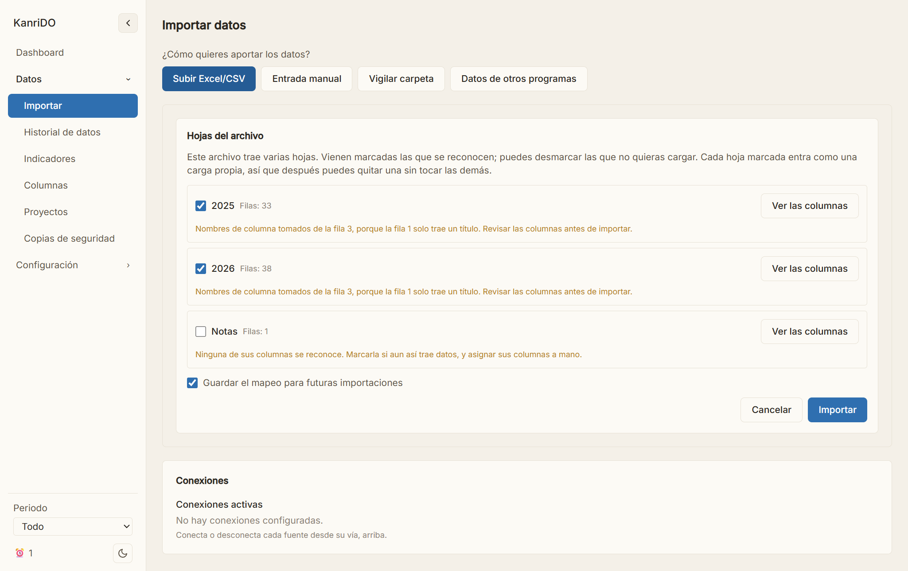

**Si encima de los nombres de columna hay un título**, como «Registro de facturas emitidas 2025»,
KanriDO se da cuenta y toma los nombres de la fila siguiente. Te lo dice en naranja. Si no ha
acertado, elige otra fila en **Fila con los nombres de columna**.

**Qué columna es cada dato.** Pulsa **Ver las columnas** para ver cómo ha entendido cada columna de
tu archivo. A la izquierda está el nombre que trae el archivo; a la derecha, lo que significa para
KanriDO. Las que ha reconocido solas llevan la marca **automático**.

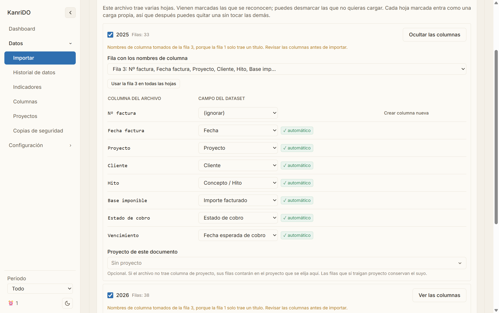

- Si una columna no está bien, cambia su valor en el desplegable.
- Si una columna no te interesa, déjala en **(ignorar)**. Se guarda igualmente con el archivo, por si
  la necesitas más adelante.
- Si una columna trae un dato que KanriDO todavía no conoce, pulsa **Crear columna nueva** y se crea
  con el nombre que tiene en tu archivo.
- Si el archivo entero es de un proyecto y no trae una columna de proyecto, elígelo en **Proyecto de
  este documento**.
- Deja marcada la casilla **Guardar el mapeo para futuras importaciones**: la próxima vez que subas
  un archivo con las mismas columnas, entrará ya asignado.

**Si una fecha se puede leer de dos maneras**, como «03/04/2025» en un archivo donde ninguna fecha
aclara si el día va delante, KanriDO te pregunta el orden antes de importar. Con una sola fecha como
«25/12/2025» ya no pregunta.

**Si subes otra vez un archivo que ya importaste** (la versión de este mes de tu libro de
facturas, por ejemplo), KanriDO te pregunta de cuál de tus archivos es versión nueva. Si le dices
cuál, la versión nueva sustituye a la anterior y no se suman las dos.

### 1.2 El resultado de la importación

Al terminar, KanriDO te dice cuántas filas han entrado y a qué periodos van, y te avisa de lo que
conviene revisar:

- **Filas con datos faltantes**: filas a las que les falta un dato, por ejemplo una fecha. Se
  arregla completando esas filas en tu archivo.
- **Filas con un dato que no se ha podido interpretar**: el dato está, pero no se entiende, como
  una fecha escrita de forma extraña. Se arregla corrigiendo esas casillas en tu archivo.
- **Columnas que han llegado vacías**: la columna está en el archivo, pero no trae ningún valor.

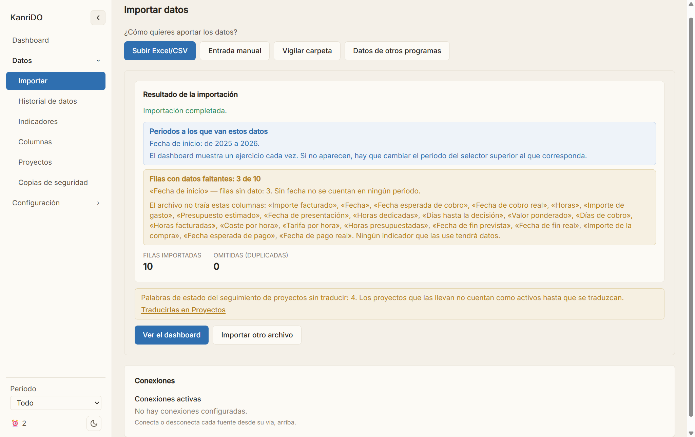

Si importas tu hoja de seguimiento de proyectos, puede que además te pida traducir las palabras que
usas para el estado de tus proyectos. Está explicado en [Proyectos](#42-los-estados-del-seguimiento).

### 1.3 La carpeta vigilada

Si tus datos llegan cada mes en archivos nuevos —partes de horas, exportaciones de tu programa de
facturación—, puedes pedirle a KanriDO que vigile la carpeta donde los guardas. Lo que aparezca ahí
entra solo.

1. Entra en **Datos › Importar** y pulsa **Vigilar carpeta**.
2. Pulsa **Elegir carpeta…** y elige la carpeta.

KanriDO mira lo que ya hay dentro y lo que vaya llegando mientras la aplicación está abierta: al
abrirla, cada pocos minutos y cuando pulsas **Actualizar ahora**. Lee también las subcarpetas, así
que puedes ordenar los archivos por años o por meses como prefieras.

**La primera vez, un archivo se confirma a mano.** Un archivo entra solo cuando KanriDO ya sabe qué
es cada una de sus columnas. Si alguna columna trae datos que nadie ha decidido todavía, el archivo
queda en **Pendientes**, con su aviso también en la bandeja de pendientes del pie de la barra
lateral.

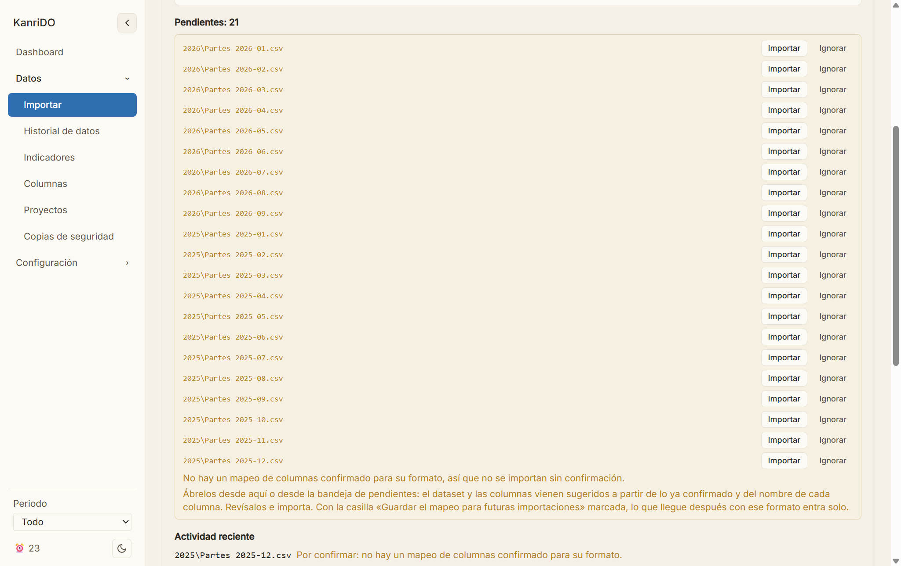

Pulsa **Importar** en uno de ellos, revisa sus columnas como en una subida normal y pulsa
**Importar** con la casilla **Guardar el mapeo para futuras importaciones** marcada. En el ejemplo, la
columna «Observaciones» queda en **(ignorar)**: también es una decisión, y se recuerda.

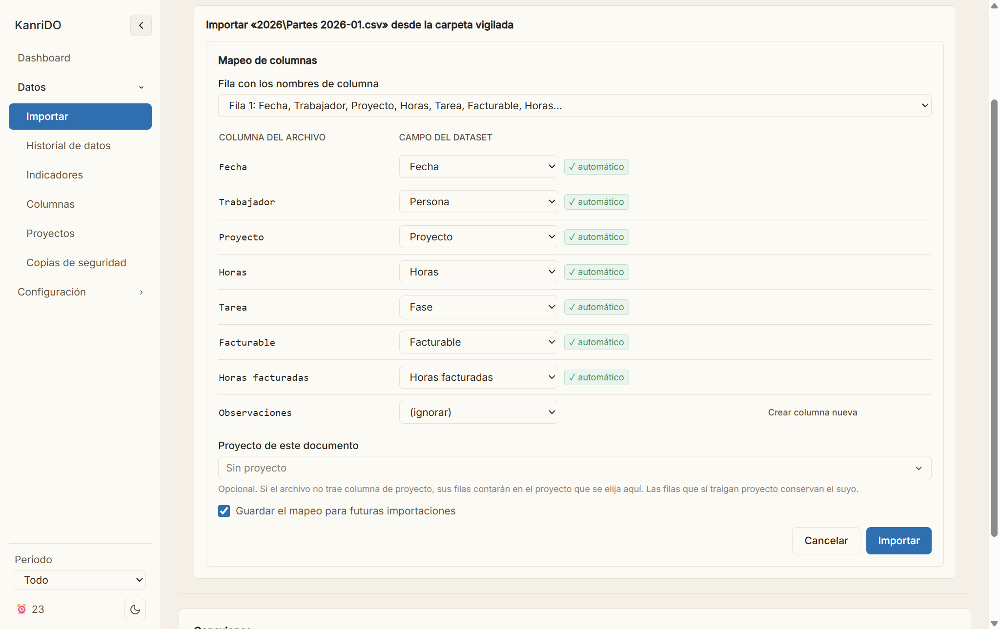

A partir de ahí, todos los archivos con esas mismas columnas —los que esperaban y los que lleguen
después— entran solos. **Actividad reciente** te dice qué ha entrado y cuántas filas traía cada uno.

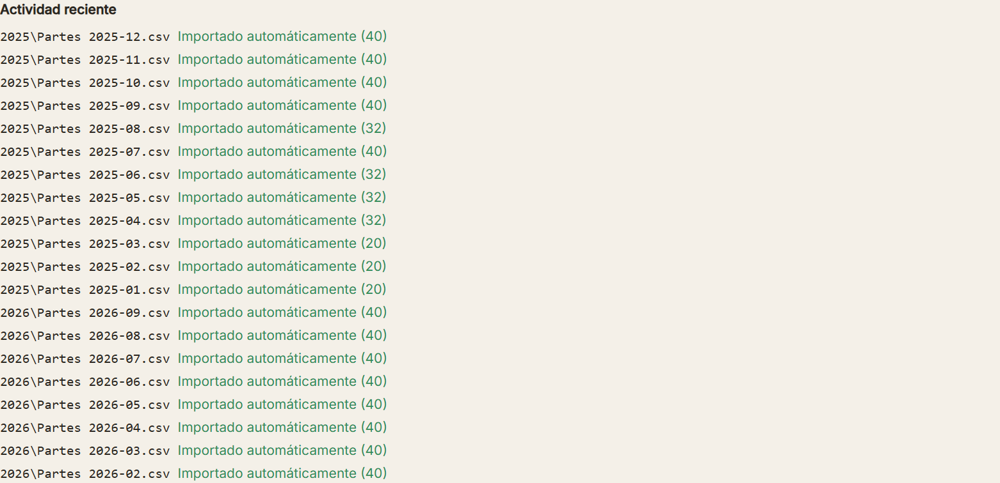

Algunas cosas que conviene saber:

- **Carpetas en la nube.** Puedes vigilar una carpeta sincronizada con OneDrive, Dropbox o Google
  Drive. Si un archivo está solo en la nube, KanriDO lo descarga para leerlo; si no puede, te avisa
  y lo vuelve a intentar en la siguiente revisión. Para evitarlo, marca la carpeta en el explorador
  de Windows para que se conserve siempre en el equipo.
- **Todo lo que hay dentro se importa**, también las copias y las versiones antiguas que guardes en
  alguna subcarpeta. Para dejar un archivo fuera, sácalo de la carpeta o pulsa **Ignorar** en su fila.
- **Un archivo que ya entró y cambia** (porque lo has actualizado) se vuelve a leer y sustituye a su
  versión anterior. Si la versión nueva no trae casi nada de la anterior —como pasa con una
  exportación de un solo mes—, no sustituye nada sin preguntarte: la pregunta te espera en la bandeja
  de pendientes.
- Los archivos temporales de Excel y los del sistema no se leen. Los que no son de un tipo que
  KanriDO sepa leer se nombran aparte, sin contar como pendientes.

### 1.4 El historial de datos

En **Datos › Historial de datos** queda todo lo que les ha pasado a tus datos: cada importación y
cada borrado, con su fecha, de dónde vino y cuántas filas movió.

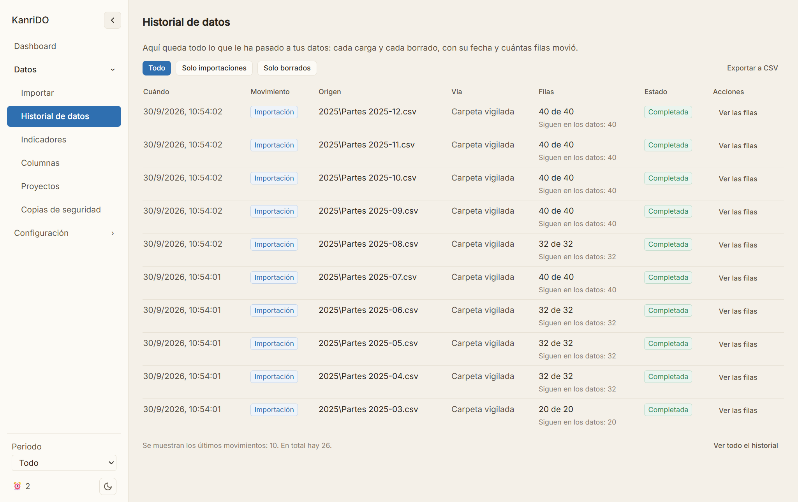

Desde aquí puedes:

- **Ver las filas** de una carga, filtrarlas y quitar las que sobren, o quitar la carga entera. Las
  cifras se recalculan en unos segundos.
- **Cambiar las columnas asignadas** de una carga, si al importarla asignaste mal alguna. No hace
  falta volver a subir el archivo: KanriDO lo guardó entero.
- Elegir el **proyecto del documento** de una carga.
- Revisar las filas que KanriDO ha señalado porque **pueden estar repetidas** (coinciden en proyecto,
  fecha e importe con otras que ya tenías): decides tú si te quedas con las dos o descartas las nuevas.
- **Exportar a CSV** el historial entero.

---

## 2. Leer las cifras

### 2.1 El dashboard

El **Dashboard** es la pantalla principal. Cada sección es un dataset —un grupo de indicadores, como
Contabilidad u Operaciones— y cada tarjeta es un indicador. Las secciones se pliegan con la flecha de
su nombre.

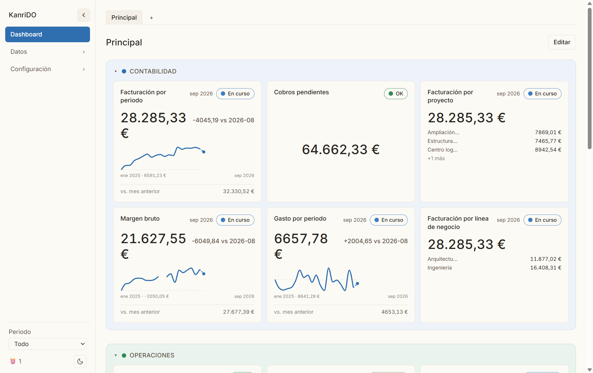

Cada tarjeta te dice:

- **El periodo** de la cifra que enseña, arriba («sep 2026»). Los indicadores de estado actual, que
  no se reparten por periodos, no lo llevan.
- **El estado** de la cifra (ver el apartado siguiente).
- **La cifra**, y a su lado la **variación** frente al periodo con el que se compara.
- Si el indicador tiene historia, un pequeño gráfico con su evolución.
- Abajo, el valor del periodo con el que se compara.

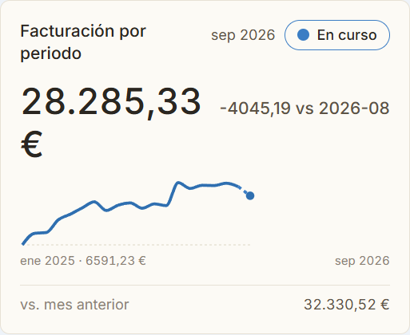

Pulsa una tarjeta para abrir su detalle.

### 2.2 Los cuatro estados de una cifra

Una cifra está siempre en uno de estos cuatro estados, y se dice igual en la tarjeta, en el gráfico
y en el detalle:

| Lo que ves | Qué significa |
|---|---|
| **OK**, o solo la cifra | La cifra está calculada con un periodo ya cerrado. |
| **En curso** | El periodo todavía no ha terminado (el mes o el trimestre actual). La cifra es correcta con los datos que hay hasta hoy y puede cambiar. |
| **Sin datos** | No hay datos para calcularla en ese periodo. KanriDO nunca pone un 0 cuando no tiene datos. |
| **No calculable** | Hay datos, pero la cuenta no tiene resultado, por ejemplo una división por cero. Pasa el ratón por encima para ver el motivo. |

Cuando una tarjeta sale **Sin datos** porque a tus archivos les falta una columna, la tarjeta la
nombra. En el ejemplo, ningún archivo trae las horas dedicadas a las propuestas:

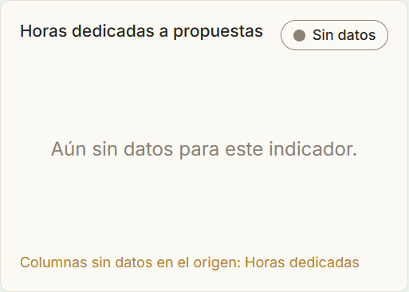

En el dashboard de un proyecto verás además **Sin reparto por proyecto** en algunos indicadores.
No es un fallo del periodo: es que ese indicador no se puede repartir por proyecto, por ejemplo
porque sus datos no dicen de qué proyecto es cada fila. La tarjeta te dice el motivo.

### 2.3 El periodo y «Todo»

El selector **Periodo**, al pie de la barra lateral, decide qué periodo miran todos los dashboards:

- **Todo**: no filtra por ejercicio. Cada tarjeta enseña la cifra de su periodo más reciente, y los
  gráficos enseñan toda la historia. **No es la suma de todo el histórico.**
- **Un ejercicio** (2026, 2025…): cada tarjeta enseña la cifra más reciente de ese ejercicio, y los
  gráficos solo ese ejercicio.

Dos ajustes de **Configuración › Calendario** cambian este comportamiento:

- **Mes de inicio del ejercicio**: si tu ejercicio fiscal no empieza en enero, indícalo aquí. Los
  trimestres y los años de todos los indicadores se cuentan desde ese mes.
- **Periodo de inicio**: con qué periodo se abre la aplicación. La elección que hagas en el selector
  vale hasta que cierras la aplicación.

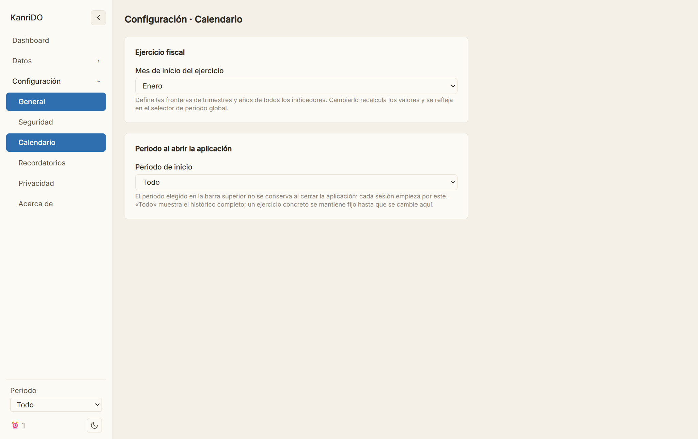

### 2.4 Las formas de ver un indicador

Cada indicador se puede ver de cinco formas:

- **KPI**: la cifra sola, grande.
- **Línea**: la evolución periodo a periodo.
- **Barra**: la cifra repartida en grupos, en barras.
- **Tarta**: la cifra repartida en grupos, como partes de un todo.
- **Tabla**: la cifra repartida en grupos, en una lista.

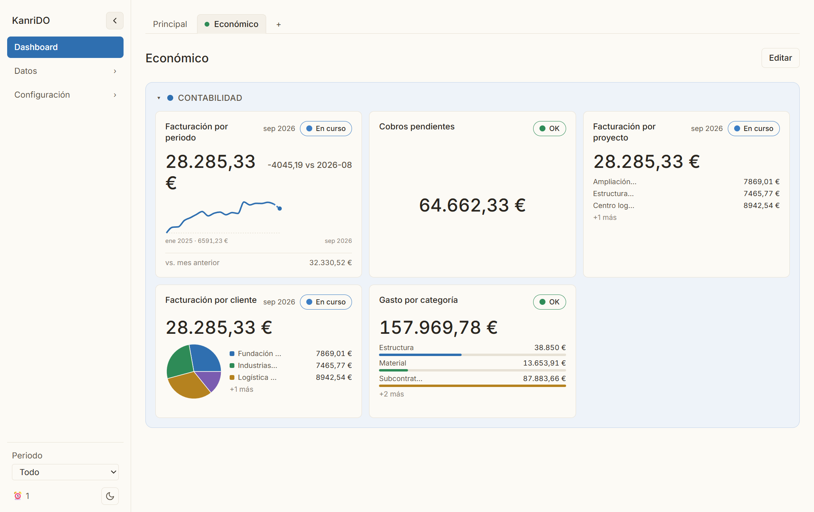

La forma se elige en **Visualización**, al editar el indicador (ver
[Crear o cambiar un indicador](#34-crear-o-cambiar-un-indicador)). Con **Automático**, KanriDO elige
por ti: el reparto si el indicador reparte por grupos, la línea si tiene varios periodos y la cifra
sola en los demás casos.

**Por qué a veces no aparece una forma.** Solo se ofrecen las que tienen sentido para ese indicador,
y debajo del desplegable se dice qué cambiar para tener las demás:

- **Línea** necesita una periodicidad mensual, trimestral o anual: un indicador de estado actual no
  tiene evolución que dibujar.
- **Barra**, **Tarta** y **Tabla** necesitan que el indicador reparta la cifra en grupos, en
  **Agrupar por**.
- **Tarta** además solo está con **Suma** o **Recuento**: una media o un porcentaje no se pueden
  partir en porciones que sumen el total.

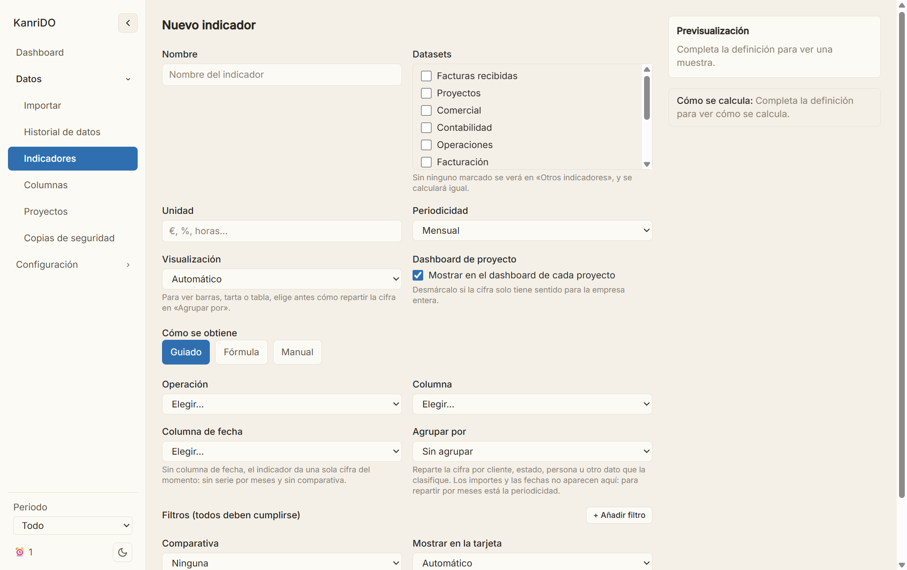

Si un periodo concreto no tiene nada que repartir, la tarjeta enseña la cifra sola ese periodo, sin
avisar: el estado de la cifra ya dice lo que pasa.

### 2.5 El detalle de un indicador

Al pulsar una tarjeta se abre su detalle, con:

- **La cifra** del periodo y su variación.
- **El gráfico de evolución**, con toda la serie del periodo elegido. El tramo **En curso** se dibuja
  con línea discontinua. El gráfico aparece cuando hay datos de dos periodos o más.
- **Cómo se calcula**: la definición del indicador en una frase, de dónde saca los datos, su
  periodicidad y su comparativa.

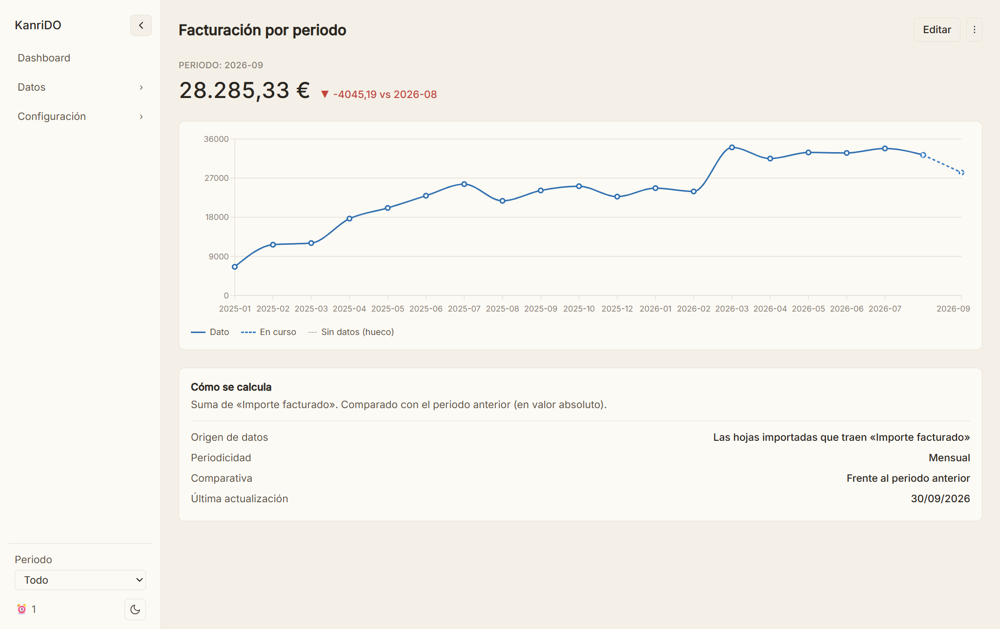

**Los desgloses.** Si el indicador reparte la cifra en grupos —por cliente, por proyecto, por
persona—, el detalle enseña el reparto completo del periodo. La tarjeta, que tiene menos sitio,
enseña los tres primeros y cuántos más hay («+2 más»).

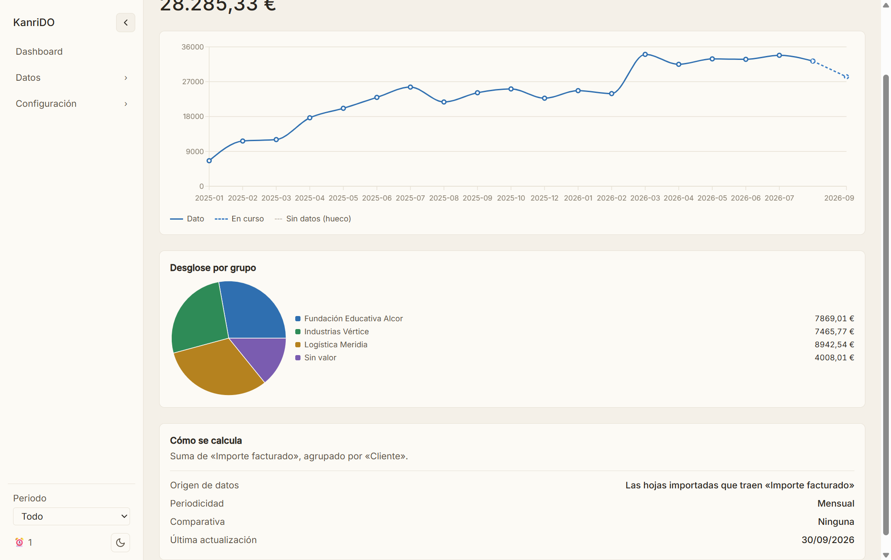

En un reparto verás a veces dos grupos especiales:

- **Sin valor**: las filas que no traen dato en la columna por la que se reparte. En el ejemplo, una
  factura de este mes no tiene cliente. Se cuentan igual en la cifra de arriba.
- **Otros**: un reparto enseña como mucho 50 grupos, los más recientes. El resto se junta en «Otros»,
  con su total. La cifra de arriba no cambia.

**La comparativa.** Un indicador puede compararse con el periodo anterior, con el mismo periodo del
año anterior, con un valor fijo o con la media de varios periodos, en valor absoluto o en
porcentaje. Se elige al editar el indicador, en **Comparativa**. Los indicadores de estado actual y
los que reparten en grupos no llevan comparativa.

**Indicadores manuales.** Si un indicador es manual (una cifra que no sale de ningún archivo), su
detalle tiene una tabla para escribir el valor de cada periodo, o para **pegar** varios de una vez.

---

## 3. Dashboards, datasets e indicadores

Tres ideas para orientarse:

- Un **indicador** es una cifra que KanriDO calcula a partir de tus datos, como «Facturación por
  periodo». La lista completa está en **Datos › Indicadores**.
- Un **dataset** es un grupo de indicadores, como «Contabilidad». En el dashboard, cada dataset es una
  sección. Un indicador puede estar en varios datasets, o en ninguno.
- Un **dashboard** es una pestaña con los indicadores que tú elijas. Puedes tener varios.

Reorganizar dashboards o datasets **nunca cambia una cifra**, y quitar un indicador de un dashboard no
lo borra: se sigue calculando y sigue en los demás dashboards que lo lleven.

### 3.1 Varios dashboards en pestañas

Las pestañas están encima del dashboard. La que tengas abierta se recuerda para la próxima vez.

- **Crear un dashboard**: pulsa **+** al final de las pestañas. El dashboard nuevo nace vacío y se
  abre en modo edición.
- **Cambiar un dashboard**: ábrelo y pulsa **Editar**. Cuando acabes, pulsa **Hecho**.

En modo edición puedes:

- Cambiarle el **nombre** (y pulsar **Guardar**) y el **color** de la pestaña.
- Moverlo a la izquierda o a la derecha con las flechas.
- Elegir **qué indicadores enseña**. Marcar un dataset lo añade como sección con todos sus indicadores
  activos; con la flecha de su nombre lo despliegas y marcas o quitas cada uno. El filtro
  **Columna** y el buscador te ayudan a encontrar un indicador concreto.
- Plegar, ocultar y ordenar las secciones.
- **Borrar este dashboard**. Sus indicadores no se borran. El último dashboard no se puede borrar: si
  quieres empezar de cero, cámbiale el nombre y quítale los indicadores.

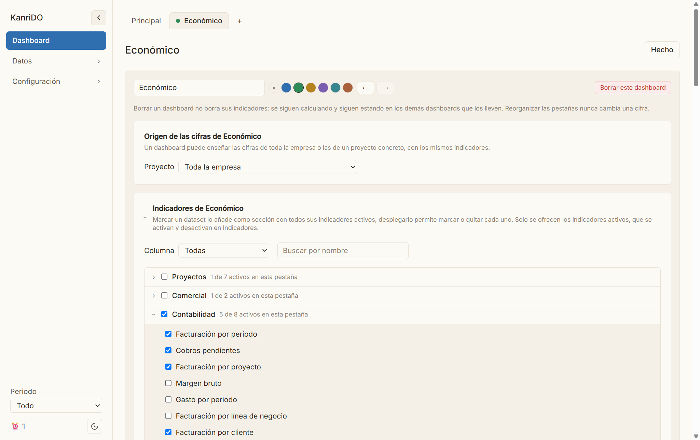

### 3.2 El dashboard de un proyecto

Un dashboard puede enseñar las cifras de un solo proyecto en lugar de las de toda la empresa, con
los mismos indicadores. En modo edición, en **Origen de las cifras**, elige el proyecto en el
desplegable **Proyecto**.

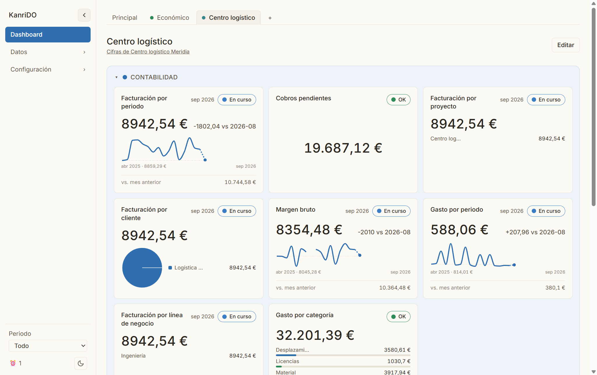

Debajo del nombre, la pestaña dice siempre de qué proyecto son sus cifras. Las cifras de un proyecto
se calculan aparte, así que la primera vez tardan unos segundos en aparecer. Para volver a las cifras
de toda la empresa, elige **Toda la empresa** en el mismo desplegable.

Si solo quieres echar un vistazo a un proyecto, no hace falta crear un dashboard: ábrelo desde su
lista (ver [La pantalla de un proyecto](#45-la-pantalla-de-un-proyecto)).

### 3.3 La lista de indicadores

En **Datos › Indicadores** está todo lo que KanriDO sabe medir en tu instalación.

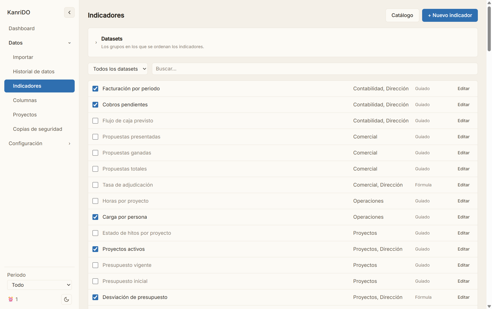

- **La casilla** de cada indicador dice si está **activo**: si se calcula. Solo los activos se pueden
  enseñar en un dashboard. Activar uno no lo añade a ningún dashboard: se marca después al editar el
  dashboard.
- A su derecha, los **datasets** en los que está, y **cómo se obtiene**: guiado, fórmula o manual.
- **Editar** abre el indicador para cambiarlo.
- El desplegable de datasets y el buscador filtran la lista.
- En **Datasets**, arriba, se crean, renombran, ordenan y borran los datasets. Un dataset nuevo nace
  vacío: para añadirle un indicador, edita ese indicador y marca el dataset.

### 3.4 Crear o cambiar un indicador

Pulsa **+ Nuevo indicador**, o **Editar** en uno que ya exista. El formulario se recorre de arriba
abajo, y a la derecha tienes la **Previsualización** de la cifra y **Cómo se calcula** en una frase,
que se actualizan mientras rellenas.

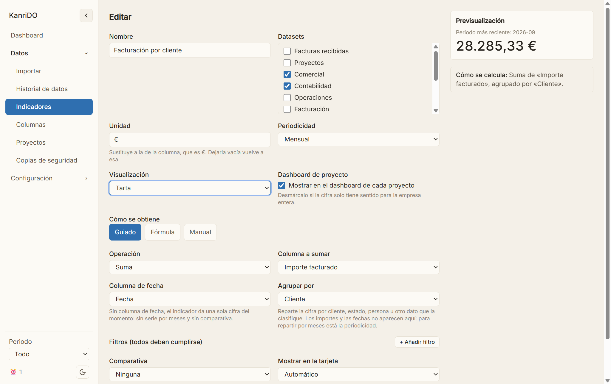

- **Nombre**, **Datasets** en los que está y **Unidad** (€, %, horas…). Si la dejas vacía, toma la de
  la columna que suma.
- **Periodicidad**: **Mensual**, **Trimestral**, **Anual** o **Estado actual** (una cifra del
  momento, sin evolución).
- **Visualización**: la forma de la tarjeta (ver [2.4](#24-las-formas-de-ver-un-indicador)).
- **Mostrar en el dashboard de cada proyecto**: desmárcalo si la cifra solo tiene sentido para la
  empresa entera.
- **Cómo se obtiene**:
  - **Guiado**: eliges una **Operación** (**Suma**, **Recuento**, **Media** o **Valores distintos**),
    la **Columna** sobre la que se hace y la **Columna de fecha** que la reparte por periodos. Sin
    columna de fecha, el indicador da una sola cifra del momento. Con **Agrupar por** repartes la
    cifra por cliente, estado, persona u otro dato que la clasifique.
  - **Fórmula**: combinas dos indicadores que ya existen, con una suma, una resta, una
    multiplicación, una división o una variación porcentual. Los dos tienen que tener la misma
    periodicidad que la fórmula. Para una cuenta más larga, crea antes los indicadores intermedios.
  - **Manual**: escribirás tú el valor de cada periodo, en el detalle del indicador.
- **Filtros**: para contar solo algunas filas, por ejemplo las facturas con estado «pendiente». Se
  tienen que cumplir todos a la vez.
- **Comparativa** y **Mostrar en la tarjeta**: con qué se compara la cifra y si la variación se ve
  en la tarjeta.

Pulsa **Guardar**. KanriDO no deja guardar una fórmula que dependa de sí misma o de un indicador que
no existe.

### 3.5 El catálogo

El **Catálogo** (botón **Catálogo** en la lista de indicadores) reúne todo lo que KanriDO sabe medir,
en paquetes por área: Contabilidad, Comercial, Proyectos, Operaciones y Dirección.

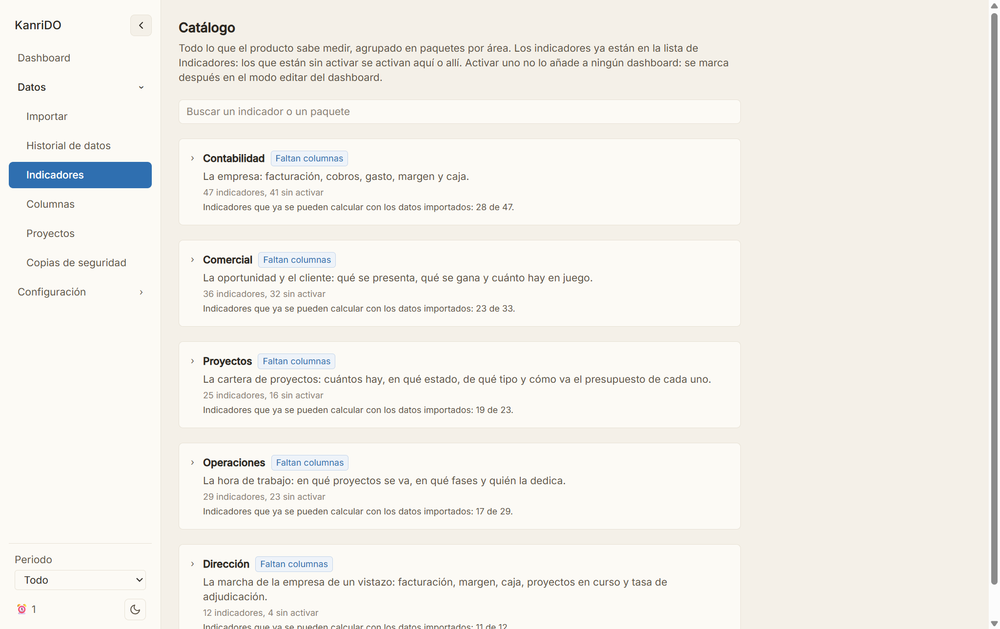

- Cada paquete dice **cuántos de sus indicadores se pueden calcular ya** con los datos que has
  importado, y los paquetes van ordenados por eso.
- Al desplegar un paquete ves sus indicadores. Los que están sin activar se activan con **Activar**.
- **Faltan columnas** te dice qué datos convendría traer para alimentar el resto: es el sitio donde
  mirar qué archivos te conviene importar.
- El buscador de arriba encuentra un indicador o un paquete por su nombre.

Todos los indicadores del catálogo están ya en tu lista de indicadores: activarlos aquí o allí es lo
mismo. Activar uno no lo añade a ningún dashboard.

---

## 4. Proyectos

### 4.1 Los proyectos se reconocen solos

No tienes que dar de alta tus proyectos. Cada código que aparece en la columna de proyecto de tus
archivos —«P-103», «2024-017», el que uses— es un proyecto, y sus cifras se pueden ver en cuanto lo
importas.

Si importas además tu **hoja de seguimiento de proyectos**, con el nombre, el estado, el tipo, la
línea de negocio o el presupuesto de cada uno, KanriDO toma de ahí esos datos. Son los que necesitan
los repartos por línea de negocio y por tipo, el recuento de proyectos activos y la desviación de
presupuesto.

La lista está en **Datos › Proyectos**. Puedes buscar por nombre o código y filtrar por estado.

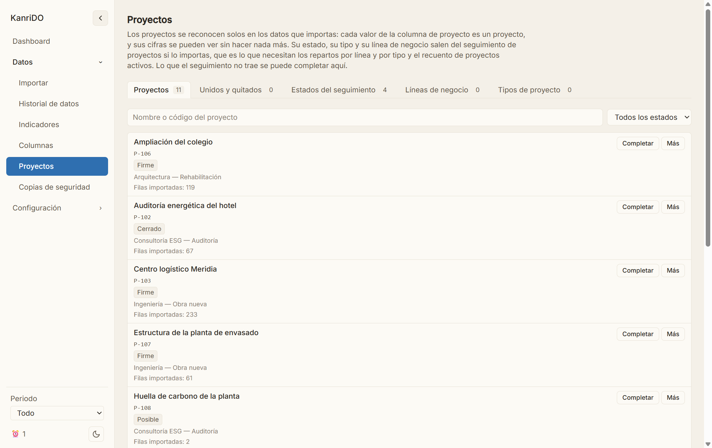

### 4.2 Los estados del seguimiento

Tu hoja de seguimiento escribe el estado de los proyectos con tus propias palabras: «En ejecución»,
«Terminado», «Ofertado»… KanriDO trabaja con cuatro estados:

- **Posible**: todavía no se ha ganado (una propuesta presentada).
- **Firme**: ganado y en marcha.
- **Cerrado**: terminado.
- **Descartado**: perdido o abandonado.

La primera vez que importas el seguimiento, KanriDO te pide que traduzcas cada palabra a uno de los
cuatro estados, en la pestaña **Estados del seguimiento**. La traducción se recuerda para las
siguientes cargas. Mientras una palabra está sin traducir, sus proyectos salen sin estado y no
cuentan como activos.

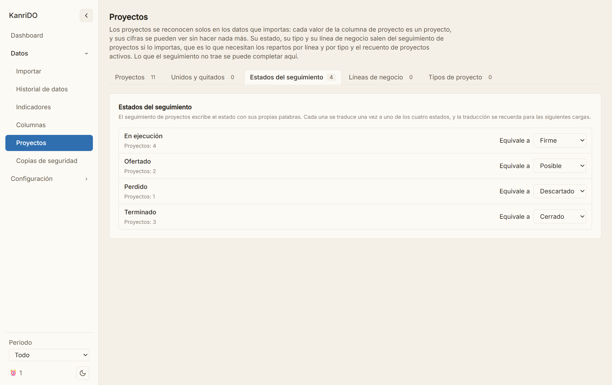

### 4.3 Completar un proyecto

Si algo de un proyecto no viene en tu seguimiento, puedes completarlo a mano: pulsa **Completar** en
su fila. Puedes darle un nombre visible, un estado, un tipo, sus líneas de negocio, sus fechas y si
tiene financiación pública.

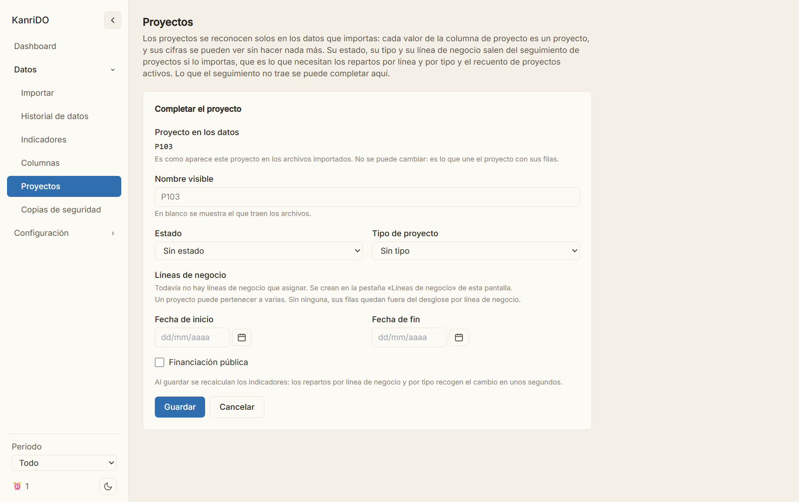

Lo que sí trae tu seguimiento aparece aquí sin poder cambiarse, con la nota «Viene del seguimiento
de proyectos»: para cambiarlo, corrígelo en el archivo y vuelve a importarlo.

El código del proyecto no se cambia nunca: es lo que une el proyecto con sus filas.

### 4.4 Unir dos códigos o quitar uno de la lista

A veces el mismo proyecto aparece con dos códigos, porque alguien lo escribió de otra forma. En el
ejemplo, una persona apuntó sus horas en «P103» en lugar de «P-103». Para arreglarlo, en la fila del
código mal escrito pulsa **Más › Unir con…** y elige el proyecto bueno.

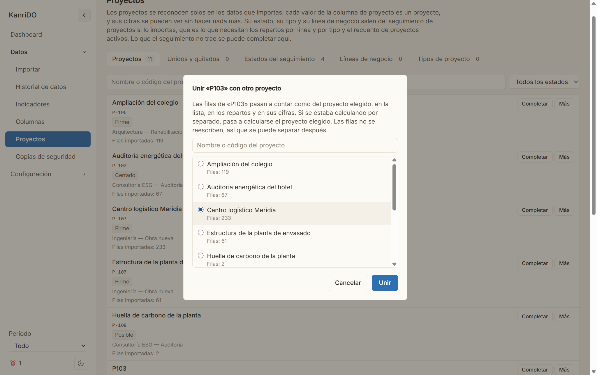

Desde ese momento, las filas de «P103» cuentan como del proyecto elegido, en la lista, en los
repartos y en sus cifras. Tus archivos y tus filas no se tocan.

Si un código no es un proyecto de verdad, pulsa **Más › Quitar de la lista**. Sus filas siguen
contando en las cifras de toda la empresa, pero dejan de contar como proyecto.

Las dos cosas se deshacen en la pestaña **Unidos y quitados**, con **Separar** o **Volver a la
lista**.

### 4.5 La pantalla de un proyecto

Para ver cómo va un proyecto, pulsa su nombre en la lista de proyectos, o en el reparto por proyecto
de cualquier tarjeta.

La pantalla del proyecto enseña la **evolución de su presupuesto** —una fila por cada carga del
seguimiento que lo trae— y sus cifras, por secciones como en el dashboard. No salen los indicadores
en los que se desmarcó **Mostrar en el dashboard de cada proyecto**.

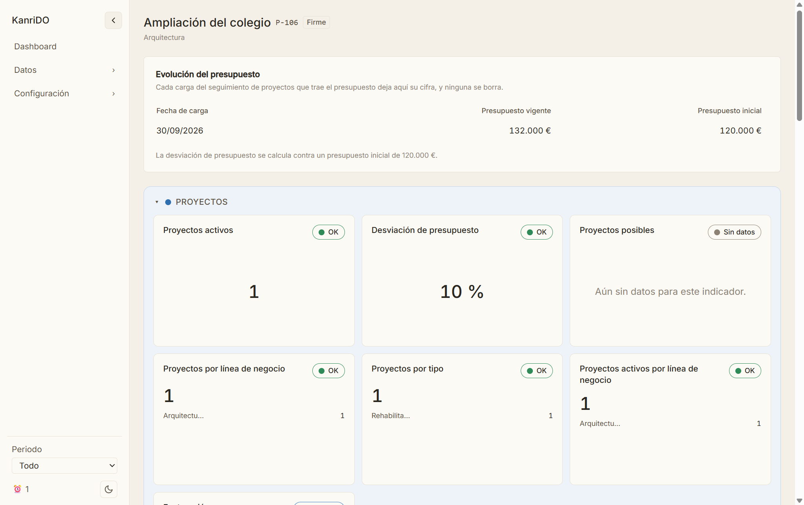

Las cifras de un proyecto se calculan aparte y solo para los proyectos que alguien mira. La primera
vez pulsa **Calcular este proyecto**: tardan unos segundos en aparecer, y a partir de ahí se
recalculan solas con cada importación. Si ya no te interesa, **Dejar de calcular este proyecto** las
retira sin tocar nada más.

---

*KanriDO 1.0. Para avisar de un fallo o proponer una mejora, escribe a kanrido.contact@gmail.com.*
