# KanriDO user guide

This guide explains how to install KanriDO and get it ready, how to bring in your data, how to read
the figures it calculates, how to organize your dashboards and KPIs, and how to work with your
projects.

The screenshots show a made-up company, an architecture and engineering firm with ten projects. None
of the data is real.

**Contents**

1. [Getting started](#1-getting-started)
2. [Bringing in your data](#2-bringing-in-your-data)
3. [Reading the figures](#3-reading-the-figures)
4. [Dashboards, datasets and KPIs](#4-dashboards-datasets-and-kpis)
5. [Projects](#5-projects)

---

## 1. Getting started

### 1.1 Installing

KanriDO runs on 64-bit Windows 10 and Windows 11. You don't need to sign up for anything: your data
stays encrypted on your computer.

1. Download the installer from the
   [releases page](https://github.com/pinnacle1010/kanrido/releases/latest).
2. Open it. Windows will show a warning because the program is new:
   [The Windows warning](https://github.com/pinnacle1010/kanrido/blob/main/WINDOWS_WARNING.pdf)
   explains how to continue and how to check that the file is the one that was published.
3. Choose **English**, accept the terms of use and follow the installer's steps.

### 1.2 First-time setup

The first time you open KanriDO, a three-step setup gets it ready. If you close it halfway, it picks
up at the same step the next time you open it.

**Step 1: preferences and password.**

- **Language**: Spanish or English. You choose it here, once: if you get it wrong, go **Back** to
  this step, because it can't be changed afterward.
- **Currency**: the symbol for your amounts. Changing it doesn't convert any amount, and you can
  change it later in **Settings › General**.
- **Local password**: type a password of at least 8 characters and repeat it. It encrypts your data
  and its backups too.

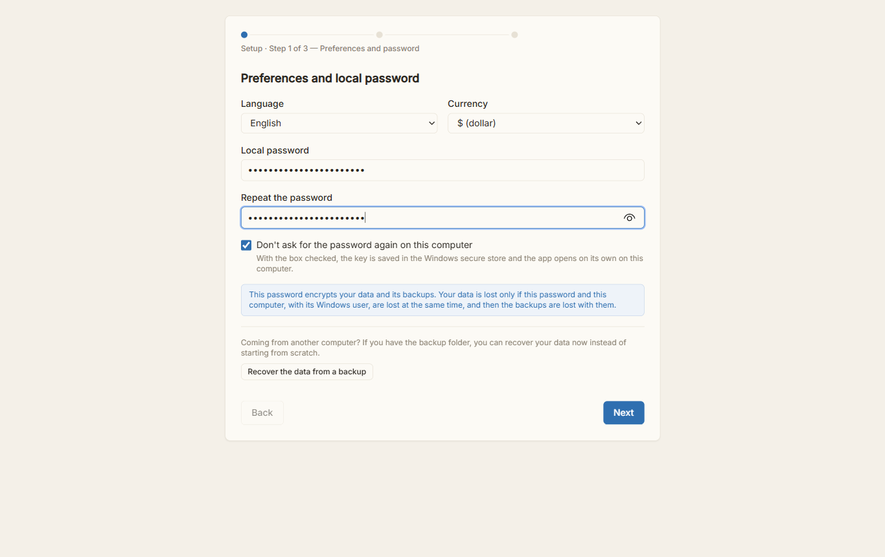

- The **Don't ask for the password again on this computer** box comes checked: that way KanriDO
  opens without asking for it on this computer. If you uncheck it, it will ask for it every time you
  open the app.
- **Your data is lost only if you lose this password and this computer, with its Windows user, at
  the same time**, and in that case the backups are lost with them. Keep the password somewhere safe.
- If you're coming from another computer and have your backup folder, click **Recover the data from
  a backup** to carry on with your data instead of starting from scratch.

**Step 2: the areas.** Check the areas of the company you want to follow: Accounting, Sales,
Projects, Operations or Management. You can check more than one. Each area will be a section of your
first dashboard, “Main”, with its KPIs.

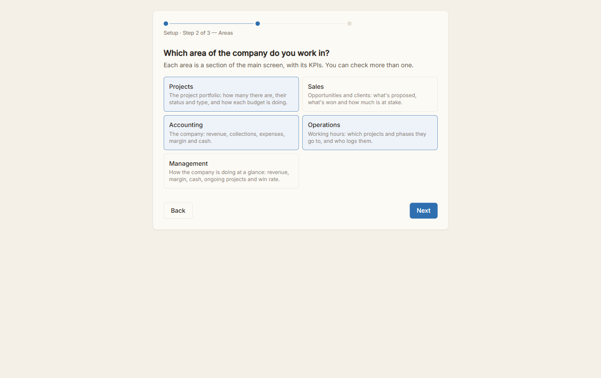

**Step 3: the first data.** KanriDO tells you which files usually hold the data for the areas you
chose. One file is enough to see the first figures.

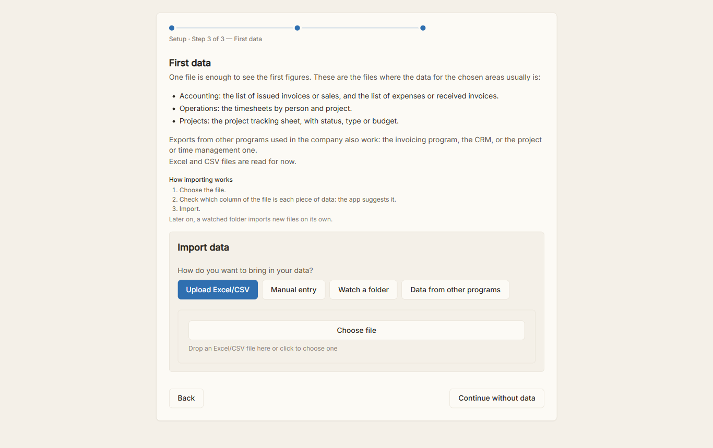

- If you have it at hand, import it right there: choose the file, check which column is each piece
  of data and click **Import**, as explained in [Uploading a file](#21-uploading-a-file). Then click
  **Create the dashboard**.
- If you'd rather start without data, click **Continue without data**. You'll see what the dashboard
  will look like, with example figures that aren't saved, and **Go to the dashboard** takes you into
  the app.

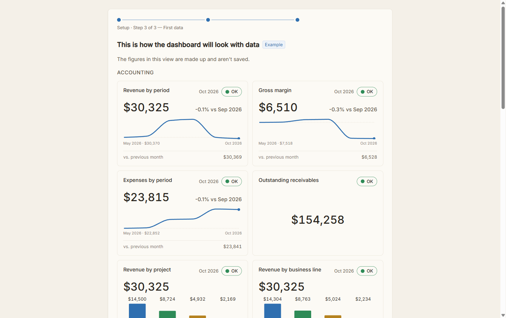

“Main” starts with KPIs from the areas you chose. The rest are in the [catalog](#45-the-catalog),
and everything can be changed later.

**The tour.** When you reach the dashboard, a short tour shows you where everything is: the sections,
the **Edit** button, the **+** to create another dashboard, the KPI list and the catalog. If you
don't need it, click **Skip the tour**.

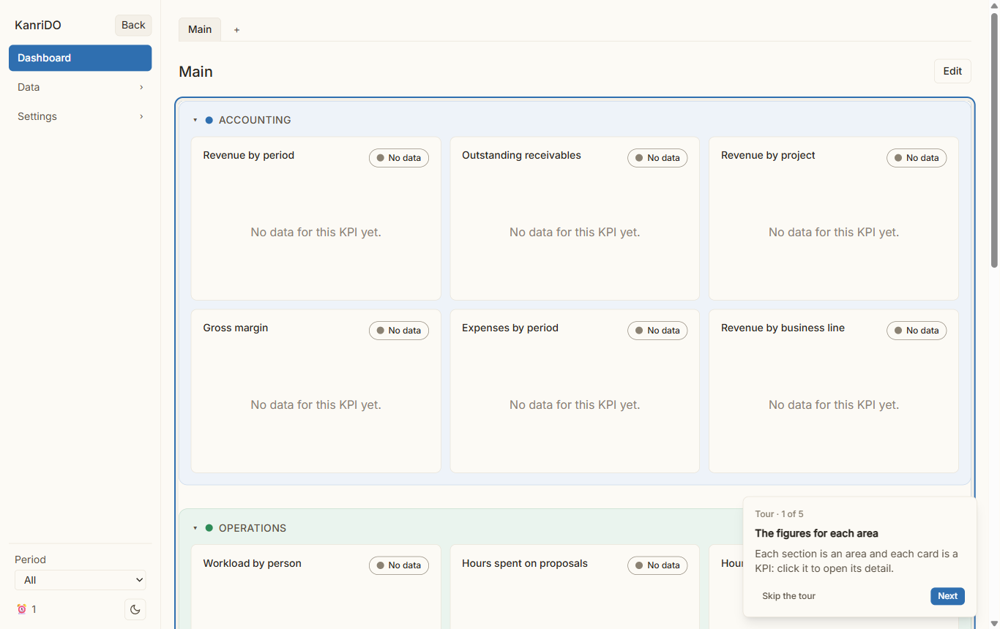

### 1.3 Finding your way around

The sidebar on the left is the same on every screen:

- **Back** takes you one step back, to the screen you were on.
- **Dashboard**: your figures. It's the screen for day-to-day use.
- **Data**: what comes in and how it's organized. Import, data history, KPIs, fields, projects and
  backups are there.
- **Settings**: the settings, which you normally change only once.
- At the bottom are the **Period** selector (see [The period and “All”](#33-the-period-and-all)),
  the **To do** tray (the clock with a number, which gathers what's waiting for a decision from you)
  and the button to switch between the light and dark themes.

### 1.4 Choosing where backups are saved

KanriDO makes a backup every day. Until you choose a folder, backups stay on the same computer and,
if the computer fails, they're lost with it. The **To do** tray, the clock at the bottom of the
sidebar, reminds you until you choose one.

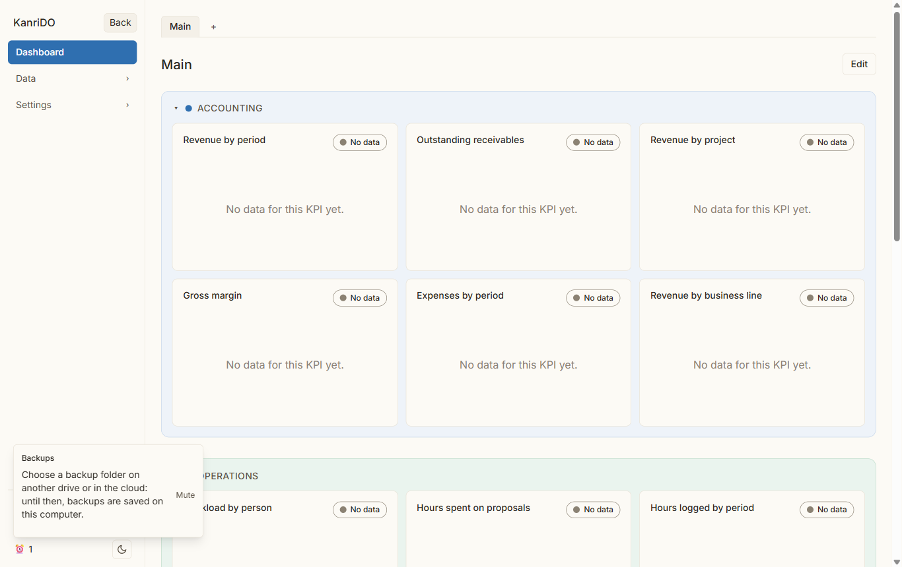

1. Go to **Data › Backups**.
2. Click **Choose folder…** and choose a folder on another drive, or a folder your cloud already
   syncs (OneDrive, Dropbox, Google Drive).

With that whole folder and your local password you can recover your data on any other computer, from
the first setup step.

On the same screen, **Back up now** makes a backup right away, and **Restore** goes back to an
earlier backup when the app restarts. The data you had until then is kept aside.

### 1.5 Updates

When it opens, KanriDO checks whether there's a new version. If there is, the **Update available**
notice appears, with the new version and the one you have installed:

- **Install** downloads and installs it. The app closes to finish installing.
- **Later** hides the notice until the next time you open KanriDO.

Nothing is downloaded or installed unless you ask, and your data is kept when you update.

---

## 2. Bringing in your data

Everything that goes into KanriDO goes through **Data › Import**. There are four ways to bring in
your data:

- **Upload Excel/CSV**: you choose a file and import it right away.
- **Manual entry**: you type a record by hand or paste a table copied from Excel or Google Sheets.
- **Watch a folder**: KanriDO imports on its own whatever shows up in a folder on your computer.
- **Data from other programs**: you export to CSV what your invoicing program, your CRM or your
  timesheet program holds, and import it like any other file.

Excel workbooks (`.xlsx`, `.xlsm`, `.xlsb`, `.xls`) and text files with columns (`.csv`, `.tsv`,
`.txt`) are read. You don't need to prepare anything: amounts like “$1,234.56”, negatives in
parentheses as accounting programs write them (“(1,234.56)”) and dates like “12/25/2025” are
understood just as you write them, and “1,500” is read as one thousand five hundred. Column names in English, such as “Customer” or “Invoice amount”, are recognized on their
own.

**Files with Spanish-style numbers.** A file that writes “1.234,56” is read the Spanish way when the
file itself makes it clear. If none of its amounts has decimals, it may not, and “1.500” would be
read as 1.5: check the figures after importing it.

### 2.1 Uploading a file

1. Go to **Data › Import** and click **Upload Excel/CSV**.
2. Choose the file, or drag it onto the upload area.
3. Check what KanriDO has recognized and click **Import**.

**If the workbook has several sheets**, the ones you leave checked are imported. Those KanriDO
doesn't recognize come unchecked, with the reason: if one has data you're interested in, check it
anyway. Later you'll be able to remove one sheet without touching the others.

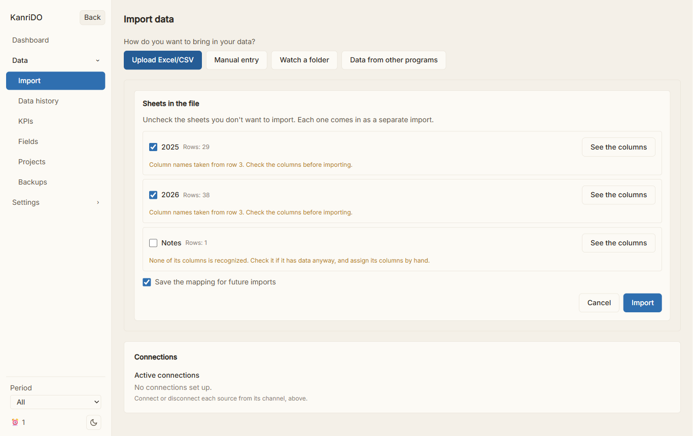

**If there's a title above the column names**, such as “Invoice register 2025”, KanriDO takes the
names from the next row and tells you so in orange. If it isn't the right row, choose another in
**Row with the column names**.

**Which column is each piece of data.** Click **See the columns** to see how it understood each
column of your file. On the left is the name the file has; on the right, under **Saved as**, the
KanriDO field where it's saved. The ones it recognized on its own carry the **automatic** mark.

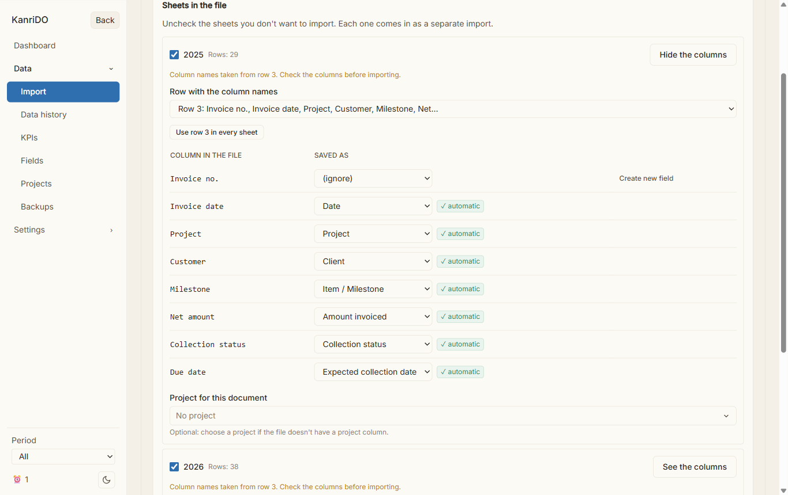

- If a column isn't right, choose another field in the drop-down.
- If you're not interested in a column, leave it on **(ignore)**. If you need it later, you can
  assign it from [data history](#24-data-history) without uploading the file again.
- If a column holds data KanriDO doesn't know yet, click **Create new field** and it's created with
  the name the column has in your file.
- If the whole file belongs to one project and has no project column, choose it in **Project for
  this document**.
- Leave the **Save the mapping for future imports** box checked: the next time you upload a file with
  the same columns, it will come in already assigned.

**Dates.** KanriDO works out on its own whether your dates put the day or the month first. If your
data doesn't make it clear, it asks you once, when importing. If the wrong one was chosen, correct it
in **Settings › General** and import again the files that came in with the wrong order, removing
them first in [data history](#24-data-history).

**If you upload a file you already imported again** (this month's version of your invoice workbook,
for example), KanriDO asks which of your files it's a new version of. If you tell it which, the new
version replaces the old one and the two aren't added together.

### 2.2 The import result

When it finishes, KanriDO tells you how many records came in and which periods they go to, and warns
you about what's worth checking:

- **Records with missing data**: records missing a piece of data, a date for example. Fix it by
  completing the data in your file.
- **Records with data that couldn't be interpreted**: the data is there but can't be understood, like
  a date written in an odd way. Fix it by correcting those cells in your file.
- **Columns that came in the file and arrived empty**: the column is in the file but has no value.
  Check the source file and, if that data doesn't exist, leave the column on **(ignore)**.

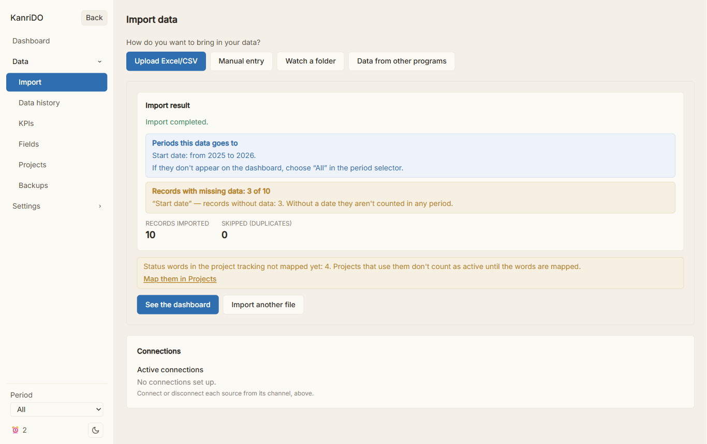

If you don't see the figures on the dashboard afterward, choose **All** in the period selector: your
data may be from another fiscal year.

If you import your project tracking sheet, it may also ask you to map the words you use for your
projects' status. That's explained in [Projects](#52-tracking-statuses).

### 2.3 The watched folder

If your data arrives every month in new files (timesheets, exports from your invoicing program), you
can ask KanriDO to watch the folder where you keep them. Whatever shows up there comes in on its own.

1. Go to **Data › Import** and click **Watch a folder**.
2. Click **Choose folder…** and choose the folder.

What's already inside and whatever arrives comes in while the app is open; if you don't want to wait,
click **Update now**. Subfolders count too, so you can sort the files by year or by month as you
like.

**The first time, each format is confirmed by hand.** A file with columns KanriDO doesn't know yet
stays under **Pending**, with its notice also in the **To do** tray at the bottom of the sidebar.

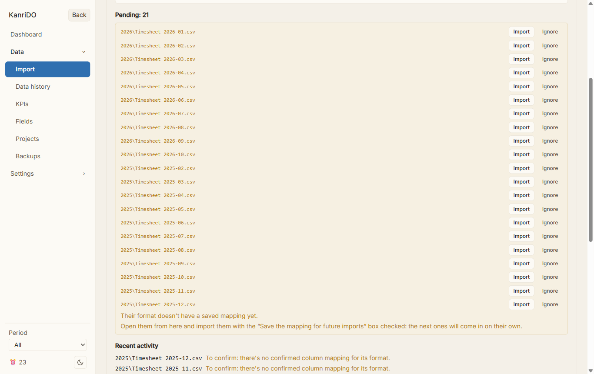

Click **Import** on one of them, check its columns as in a normal upload and click **Import** with
the **Save the mapping for future imports** box checked. In the example, the “Comments” column stays
on **(ignore)**: that's a decision too, and it's remembered.

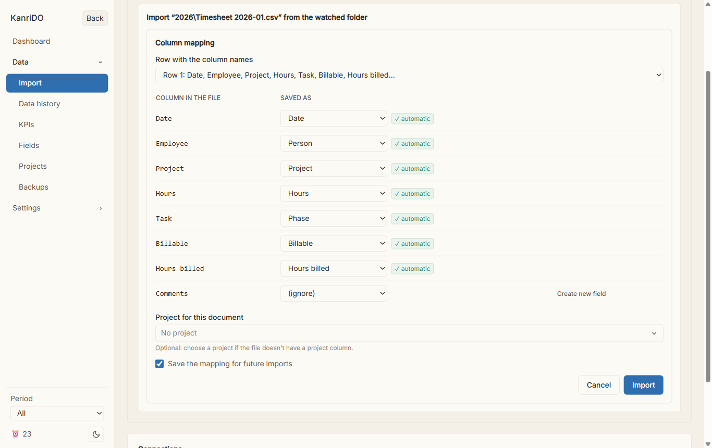

From then on, every file with those same columns, both the ones that were waiting and the ones that
arrive later, comes in on its own. **Recent activity** tells you what came in and how many rows each
one had.

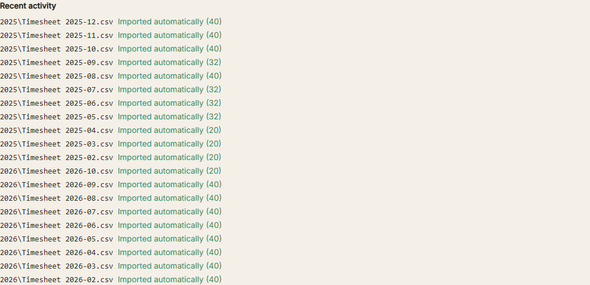

A few things worth knowing:

- **Cloud folders.** You can watch a folder synced with OneDrive, Dropbox or Google Drive. If a file
  is only in the cloud and can't be downloaded, it waits under **Pending** and comes in on its own
  when it can. To avoid this, set the folder in File Explorer to always keep it on this device.
- **Everything inside is imported**, including copies and old versions you keep in a subfolder. To
  leave a file out, take it out of the folder or click **Ignore** next to its name.
- **If you update a file that already came in**, the new version replaces the old one. If it's
  missing rows from the old one, like an export of a single month, the **To do** tray asks you
  whether it replaces it or adds to it.
- **Unclear dates.** If KanriDO doesn't know yet which order you write dates in, the file waits under
  **Pending**. Open it and choose the order when importing: the others that were waiting will come in
  on their own.
- Files KanriDO can't read, like a PDF, appear separately and don't count as pending.

### 2.4 Data history

**Data › Data history** keeps everything that has happened to your data: every import and every
deletion, with its date, where it came from and how many records it moved.

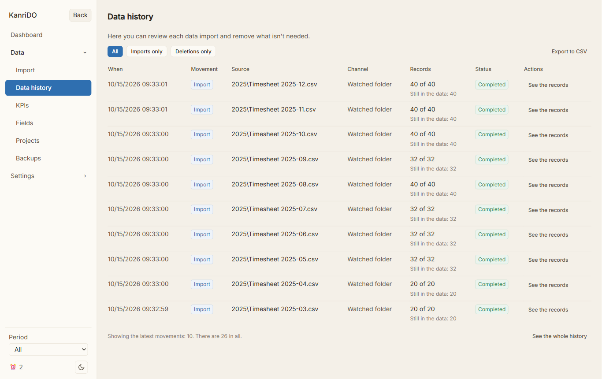

From here you can:

- **See the records** of an import, filter them and remove the ones you don't need, or remove the
  whole import. The figures are recalculated in a few seconds.
- **Change the assigned columns** of an import, if you assigned one wrong when importing it, without
  uploading the file again.
- Choose the **project for the document** of an import.
- Review the records KanriDO has flagged because they **may be repeated** (they match others you
  already had in project, date and amount): you decide whether to keep both or discard the new ones.
- **Export to CSV** the whole history.

---

## 3. Reading the figures

### 3.1 The dashboard

The **Dashboard** is the main screen. Each section is a dataset (a group of KPIs, like Accounting or
Operations) and each card is a KPI. Sections collapse with the arrow next to their name.

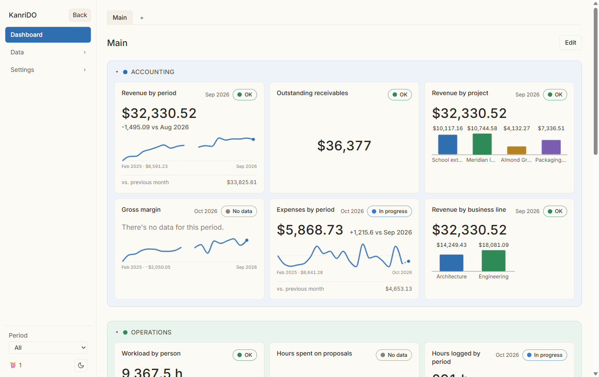

Each card tells you:

- **The period** of the figure it shows, at the top (“Sep 2026”). Snapshot KPIs, which aren't split
  into periods, don't have one.
- **The status** of the figure (see the next section).
- **The figure**, and next to it the **change** from the period it's compared with.
- Below, its trend or its split into groups, depending on the chosen view (see
  [Ways to view a KPI](#34-ways-to-view-a-kpi)).
- At the bottom, the value of the period it's compared with.

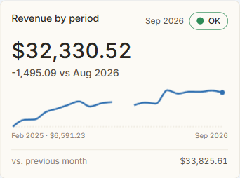

Click a card to open its detail.

### 3.2 The four states of a figure

A figure is always in one of these four states, and it's named the same way on the card, in the
chart and in the detail:

| What you see | What it means |
|---|---|
| **OK**, or just the figure | The figure is calculated from a period that's already closed. |
| **In progress** | The period hasn't ended yet (the current month or quarter). The figure is correct with the data available so far and may change. |
| **No data** | There's no data to calculate it for that period. KanriDO never shows a 0 when it has no data. |
| **Can't be calculated** | There's data, but the calculation has no result, a division by zero for example. Hover over it to see the reason. |

When a card shows **No data** because no file has the data it needs, the card names the missing
field. To get that figure, import a file that has that data. In the example, no file has the hours
spent on proposals:

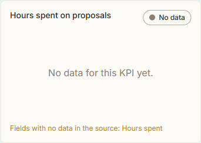

On a project's dashboard you'll also see **No breakdown by project** on some KPIs. It isn't a
problem with the period: that KPI can't be split by project, for example because its data doesn't
say which project each record belongs to. The card tells you the reason.

### 3.3 The period and “All”

The **Period** selector, at the bottom of the sidebar, decides which period all the dashboards look
at:

- **All**: doesn't filter by fiscal year. Each card shows the figure for its most recent period, and
  the charts show the whole history. **It isn't the total of the whole history.**
- **A fiscal year** (2026, 2025…): each card shows the most recent figure in that fiscal year, and
  the charts show only that fiscal year.

Two settings in **Settings › Calendar** change this behavior:

- **Fiscal year start month**: if your fiscal year doesn't start in January, set it here. Every
  KPI's quarters and years are counted from that month.
- **Starting period**: the period the app opens in. The choice you make in the selector lasts until
  you close the app.

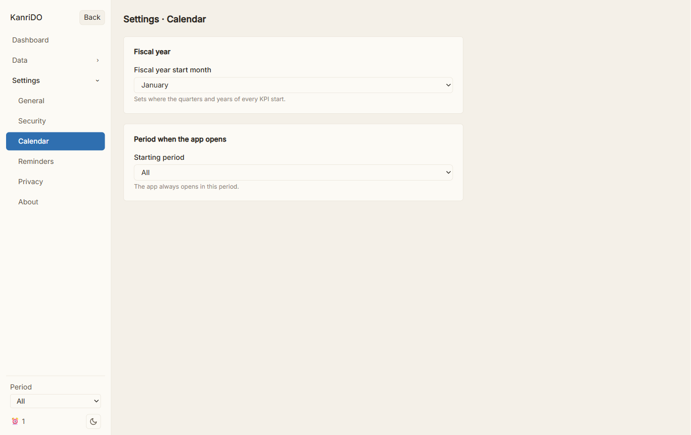

### 3.4 Ways to view a KPI

Each KPI can be viewed in five ways:

- **Number**: the figure on its own, large.
- **Line**: the trend period by period.
- **Bar**: the figure split into groups, in columns on the card and in horizontal bars in the detail.
- **Pie**: the figure split into groups, as parts of a whole.
- **Table**: the figure split into groups, in a list.

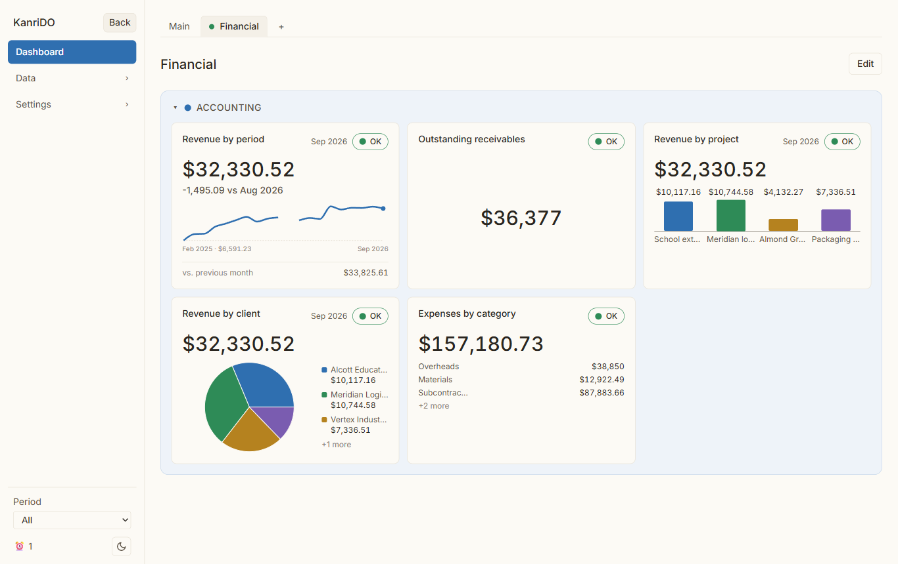

The view is chosen in **Visualization**, when editing the KPI (see
[Creating or changing a KPI](#44-creating-or-changing-a-kpi)), and with **Automatic** KanriDO
chooses it. KPIs from the catalog already come with a view chosen, which you can change just the
same.

**If the view you want doesn't appear.** Only the views that fit the KPI are offered, and below the
drop-down it says what to change to get the others:

- **Line** needs a monthly, quarterly or annual periodicity.
- **Bar**, **Pie** and **Table** need the KPI to split the figure into groups, in **Group by**.
- **Pie**, in addition, is only available with **Sum** or **Count**.

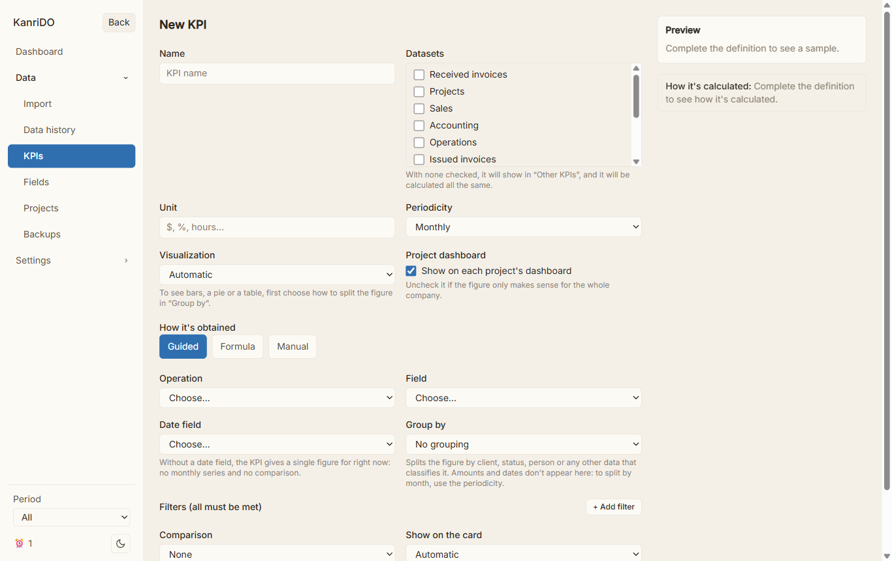

Sometimes, in a particular period, the card doesn't show the chosen view: when that period has
nothing to split, or when in a pie some group is negative because of a credit note or a refund. It
isn't a problem, and in the other periods the chosen view comes back.

### 3.5 A KPI's detail

When you click a card its detail opens, with:

- **The figure** for the period and its change.
- **The trend chart**, with every year even if you've chosen one. The **In progress** stretch is
  drawn with a dashed line. A period with no data shows as a gap in the line, never as a zero. The
  chart appears when there's data for two or more periods.
- **How it's calculated**: the KPI's definition in one sentence, where it gets its data from, its
  periodicity and its comparison.

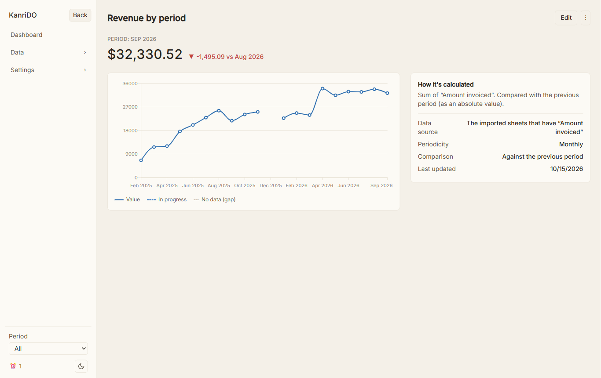

**Breakdowns.** If the KPI splits the figure into groups (by client, by project, by person), the
detail shows the period's full breakdown instead of the trend chart. To see the trend too, choose
the **Line** view. The card, which has less room, shows only the first groups and how many more
there are (“+2 more”).

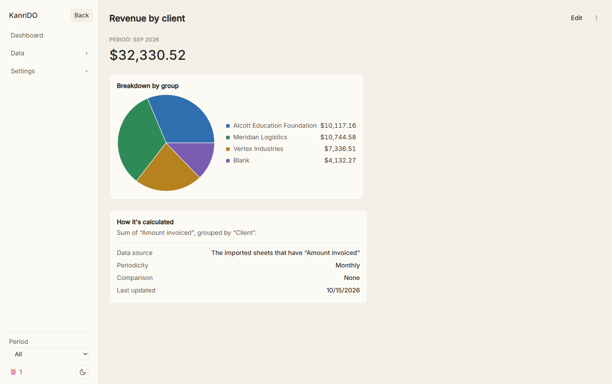

You'll sometimes see two special groups in a breakdown:

- **Blank**: the records with no data in the field the figure is split by. In the example, one
  invoice this month has no client. They still count in the figure at the top; to split them,
  complete that data in your file.
- **Other**: if there are more than 50 groups, the least recent ones are gathered here, with their
  total. The figure at the top doesn't change.

**The comparison.** A KPI can be compared with the previous period, the same period last year, a
fixed value or the average of several periods, as an absolute value or a percentage. It's chosen when
editing the KPI, in **Comparison**. Snapshot KPIs and those that split into groups don't have a
comparison.

**Manual KPIs.** If a KPI is manual (a figure that doesn't come from any file), its detail has a
table to type the value for each period, or to **paste** several at once.

---

## 4. Dashboards, datasets and KPIs

Three ideas to find your way:

- A **KPI** is a figure KanriDO calculates from your data, like “Revenue by period”. The full list is
  in **Data › KPIs**.
- A **dataset** is a group of KPIs, like “Accounting”. On the dashboard, each dataset is a section.
  A KPI can be in several datasets, or in none.
- A **dashboard** is a tab with the KPIs you choose. You can have several.

Reorganizing dashboards or datasets **never changes a figure**, and removing a KPI from a dashboard
doesn't delete it: it stays in the KPI list and on the other dashboards that have it.

If a dashboard shows a KPI without the dataset it belongs to, the card appears at the end, under
**Other KPIs**. Its figure is just as correct. To place it in a section, assign it a dataset in
**Data › KPIs** or add its dataset to the dashboard when editing it.

### 4.1 Several dashboards in tabs

The tabs are above the dashboard. The one you have open is remembered for next time.

- **Create a dashboard**: click **+** at the end of the tabs. The new dashboard starts empty and
  opens in edit mode.
- **Change a dashboard**: open it and click **Edit**. When you're done, click **Done**.

In edit mode you can:

- Change its **name** (and click **Save**) and the tab's **color**.
- Move it left or right with the arrows.
- Choose **which KPIs it shows**. Checking a dataset adds it as a section with all its active KPIs;
  with the arrow next to its name you expand it and check or uncheck each one. The **Field** filter
  and the search box help you find a particular KPI.
- Collapse, hide and sort the sections.
- **Delete this dashboard**. Its KPIs aren't deleted. The last dashboard can't be deleted: if you
  want to start from scratch, rename it and remove its KPIs.

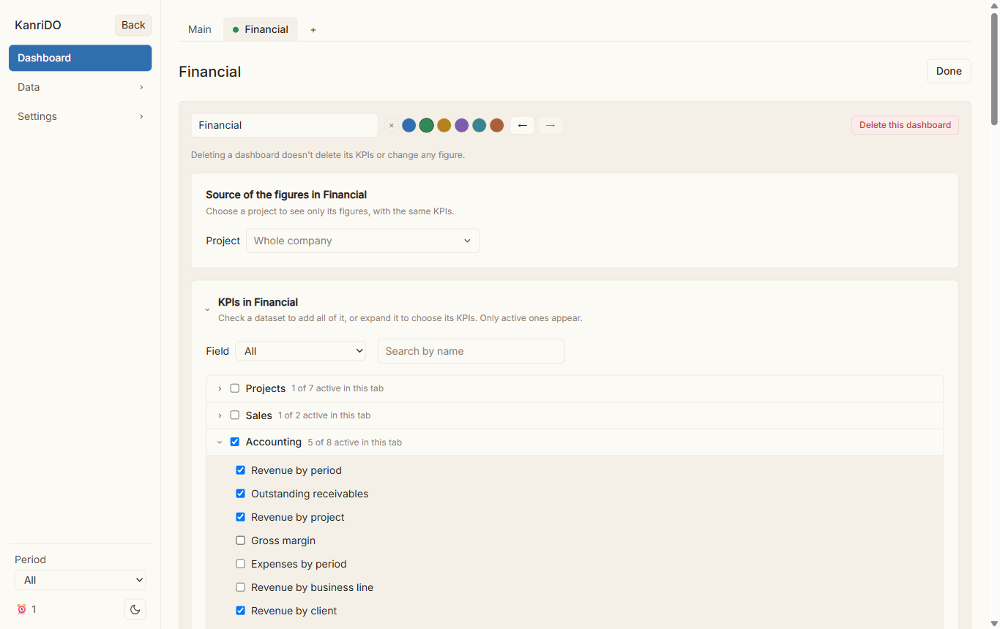

### 4.2 A project's dashboard

A dashboard can show the figures of a single project instead of those of the whole company, with the
same KPIs. In edit mode, under **Source of the figures**, click **Project** and search for the
project by its name or its code.

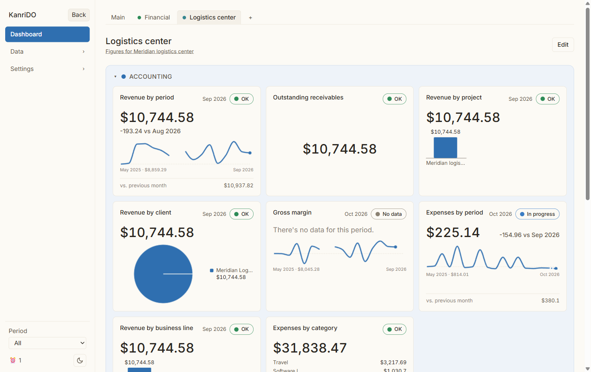

Below the name, the tab always says which project its figures are from. The first time, the figures
take a few seconds to appear. To go back to the whole company's figures, choose **Whole company** in
that same list.

If you just want to take a look at a project, you don't need to create a dashboard: open it from the
project list (see [A project's screen](#56-a-projects-screen)).

### 4.3 The KPI list

**Data › KPIs** holds everything KanriDO can measure in your installation.

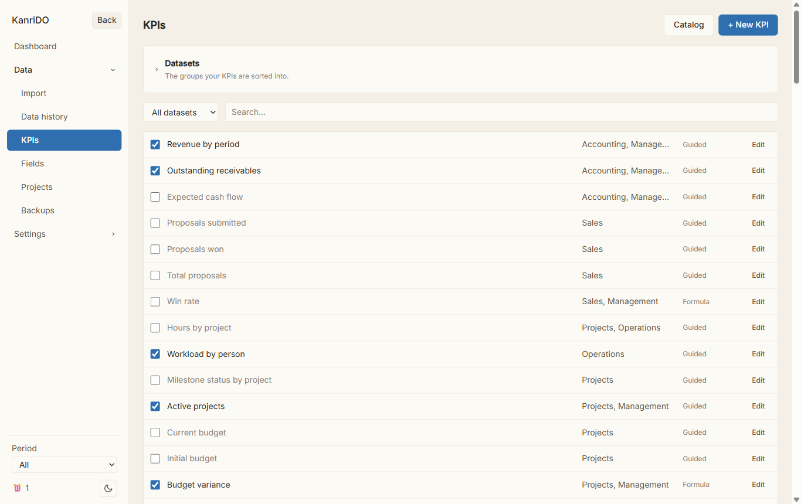

- **The checkbox** for each KPI says whether it's **active**: whether it's calculated. Only active
  KPIs can be shown on a dashboard. Turning one on doesn't add it to any dashboard: you check it
  afterward when editing the dashboard.
- To its right, the **datasets** it's in, and **how it's obtained**: guided, formula or manual.
- **Edit** opens the KPI to change it.
- The datasets drop-down and the search box filter the list.
- In **Datasets**, at the top, datasets are created, renamed, sorted and deleted. A new dataset
  starts empty: to add a KPI to it, edit that KPI and check the dataset.

### 4.4 Creating or changing a KPI

Click **+ New KPI**, or **Edit** on one that already exists. The form is filled in from top to
bottom, and on the right you have the **Preview** of the figure and **How it's calculated** in one
sentence, which update as you fill it in.

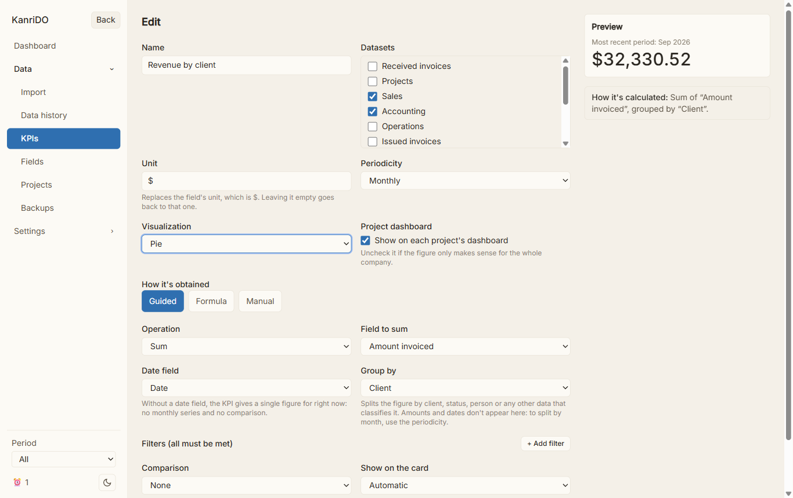

- **Name**, the **Datasets** it's in and **Unit** ($, %, h…). If you leave it empty, it takes the
  unit of the field it adds up.
- **Periodicity**: **Monthly**, **Quarterly**, **Annual** or **Snapshot** (a figure for the moment,
  with no trend).
- **Visualization**: the card's view (see [3.4](#34-ways-to-view-a-kpi)).
- **Show on each project's dashboard**: uncheck it if the figure only makes sense for the whole
  company.
- **How it's obtained**:
  - **Guided**: you choose an **Operation** (**Sum**, **Count**, **Average** or **Distinct
    values**), the field it works on and the **Date field** that splits it into periods. With no
    date field, the KPI gives a single figure for the moment. With **Group by** you split the figure
    by client, status, person or any other data that classifies it.
  - **Formula**: you combine two KPIs that already exist, with an addition, a subtraction, a
    multiplication, a division or a percentage change. Both must have the same periodicity as the
    formula. For a longer calculation, create the intermediate KPIs first.
  - **Manual**: you'll type the value for each period yourself, in the KPI's detail.
- **Filters**: to count only some records, for example the invoices with the status “unpaid”. All of
  them must be met at once.
- **Comparison** and **Show on the card**: what the figure is compared with and whether the change
  shows on the card.

Click **Save**. KanriDO won't save a formula that depends on itself or on a KPI that doesn't exist.

### 4.5 The catalog

The **Catalog** (the **Catalog** button in the KPI list) gathers everything KanriDO can measure, in
packs by area: Accounting, Sales, Projects, Operations and Management.

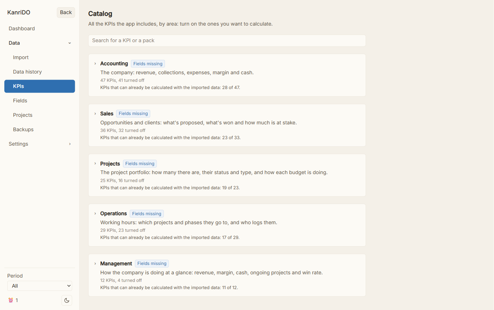

- Each pack says **how many of its KPIs can already be calculated** with your data.
- When you expand a pack you see its KPIs. The ones that are off are turned on with **Turn on**.
- **Fields missing** tells you which data would be worth bringing in to feed the rest: it's the place
  to look for which files you should import.
- The search box at the top finds a KPI or a pack by its name.

Every KPI in the catalog is already in your KPI list: turning it on here or there is the same.
Turning one on doesn't add it to any dashboard.

---

## 5. Projects

### 5.1 Projects are recognized on their own

You don't have to register your projects. Every code that appears in the project column of your
files (“P-103”, “2024-017”, whichever you use) is a project, and its figures can be seen as soon as
you import it.

If you also import your **project tracking sheet**, with each project's name, status, type, business
line or budget, KanriDO takes that data from there. It's what the breakdowns by business line and by
type, the count of active projects and the budget variance need.

The list is in **Data › Projects**. You can search by name or code and filter by status.

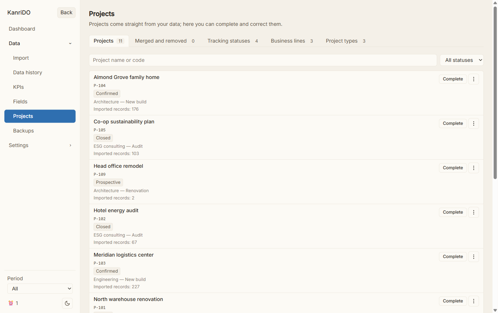

### 5.2 Tracking statuses

Your tracking sheet writes the projects' status in your own words: “Ongoing”, “Completed”,
“Proposal sent”… KanriDO works with four statuses:

- **Prospective**: not won yet (a submitted proposal).
- **Confirmed**: won and under way.
- **Closed**: finished.
- **Discarded**: lost or abandoned.

The first time you import the tracking sheet, KanriDO asks you to map each word to one of the four
statuses, in the **Tracking statuses** tab. The mapping is remembered for future imports. While a
word is unmapped, its projects have no status and don't count as active.

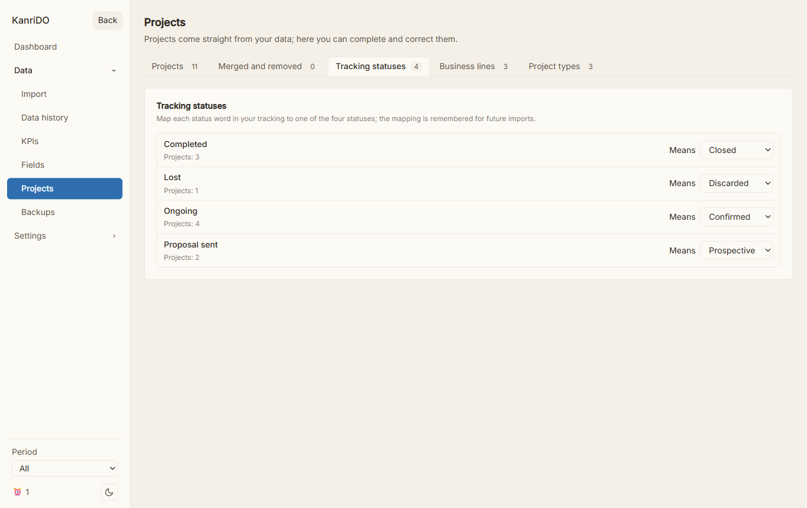

### 5.3 Completing a project

If something about a project isn't in your tracking sheet, you can complete it by hand: click
**Complete** next to its name. You can give it a display name, a status, a type, its business lines,
its dates and whether it has public funding.

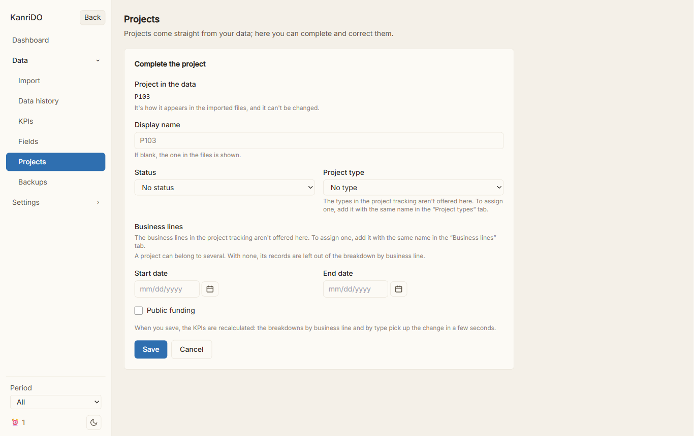

Whatever your tracking sheet does have appears here and can't be changed, with the note “It comes
from the project tracking”: to change it, correct it in the file and import it again.

The project code can't be changed. If the same project appears with two codes, merge them (see
[Merging two codes](#55-merging-two-codes-or-removing-one-from-the-list)).

### 5.4 Business lines and project types

They're two ways of grouping your projects, and each one has its tab in **Data › Projects**:

- **Business lines**: the divisions the activity is split into, like Architecture or Engineering. A
  project can be in several at once.
- **Project types**: the nature of the work, like new build, renovation or audit. It doesn't depend
  on the business line.

The KPIs that split by business line or by type use these groups. Each line and each type says how
many projects it has.

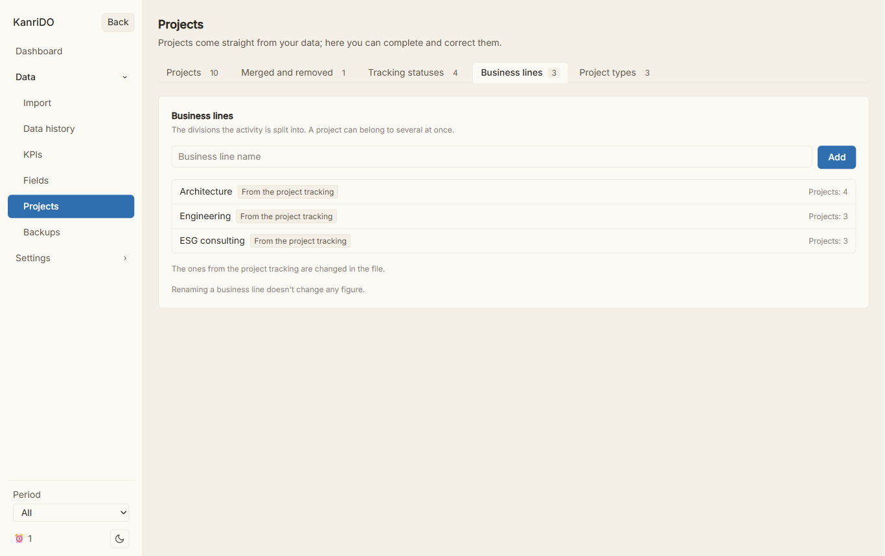

**The ones your tracking sheet brings** appear on their own, with the **From the project tracking**
mark. They aren't changed here: they're corrected in the file and imported again.

**The ones that aren't in any file** are added by hand: type the name and click **Add**. Then they're
assigned to each project from **Complete**.

To assign a project a line or a type that only the tracking sheet has, add it here with the same
name: that way it appears in **Complete**.

You can also:

- **Rename** a line or a type. Only the name you see changes, and the figures already calculated are
  kept.
- **Delete** a line or a type that no project has assigned.

### 5.5 Merging two codes or removing one from the list

Sometimes the same project appears with two codes, because someone wrote it differently. In the
example, one person logged their hours under “P103” instead of “P-103”. To fix it, next to the
misspelled code click the three-dot button (**⋮**), choose **Merge with…** and check the right
project.

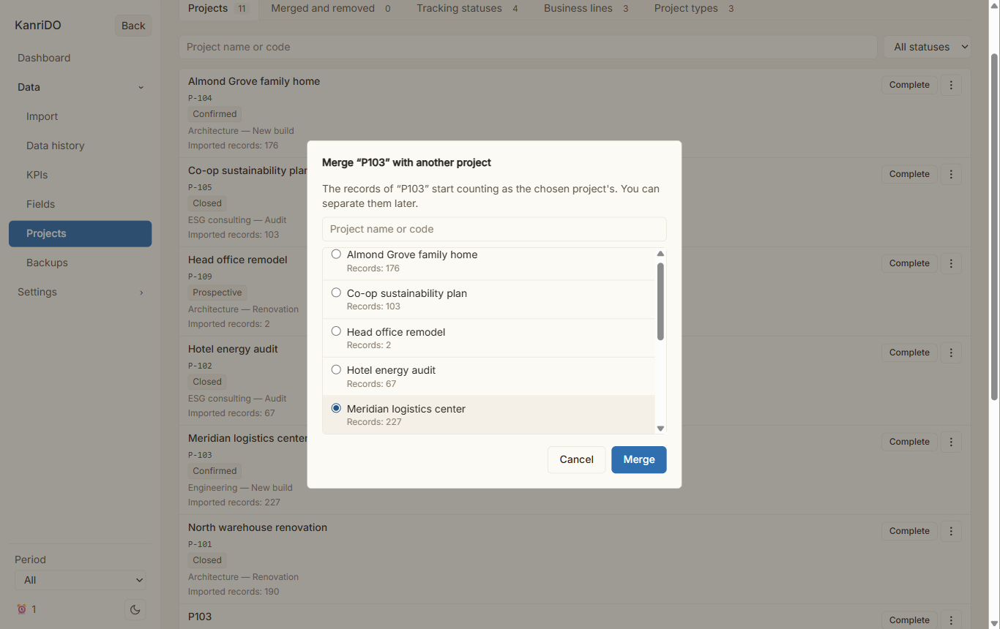

From then on, the records of “P103” count as the chosen project's, in the list, in the breakdowns
and in its figures. Your files and your records aren't touched.

If a code isn't a real project, click **⋮ › Remove from the list**. Its records still count in the
whole company's figures, but they no longer count as a project.

Both can be undone in the **Merged and removed** tab, with **Separate** or **Put back on the list**.

### 5.6 A project's screen

To see how a project is going, click its name in the project list, or in the breakdown by project of
any card.

The project screen shows its **Budget history** (one figure for each import of the tracking sheet
that includes it) and its figures, by sections as on the dashboard. KPIs where **Show on each
project's dashboard** was unchecked don't appear.

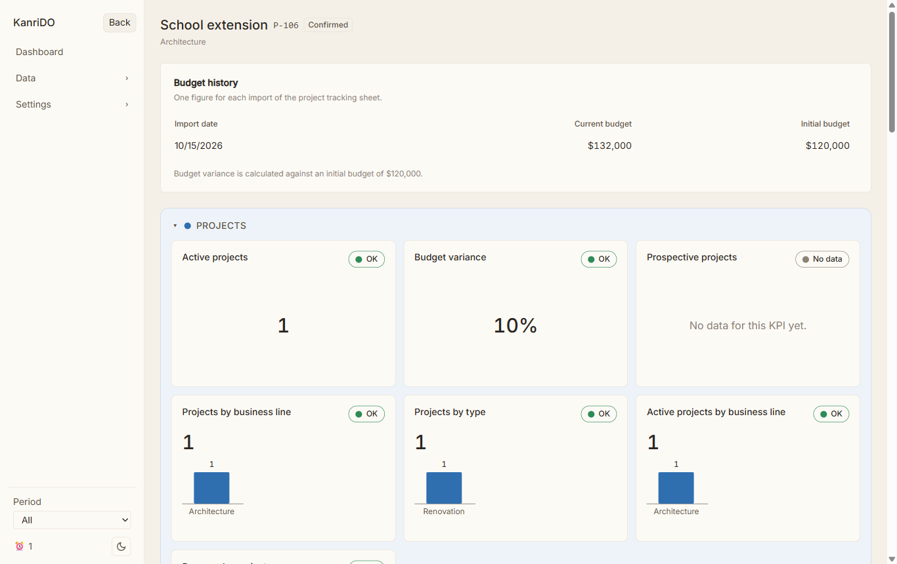

The first time, click **Calculate this project**: the figures take a few seconds to appear and then
update on their own with each import. If you're no longer interested, click **Stop calculating this
project**; nothing else is deleted.

---

*KanriDO 1.1.0. To report a problem or suggest an improvement, write to kanrido.contact@gmail.com.*
